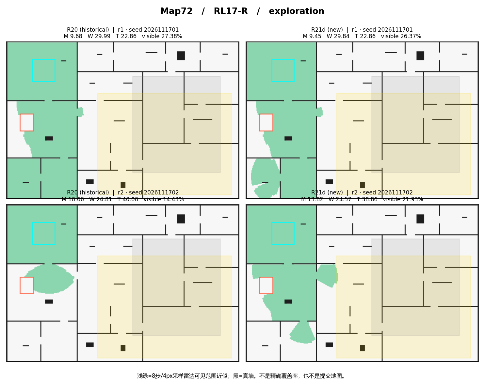
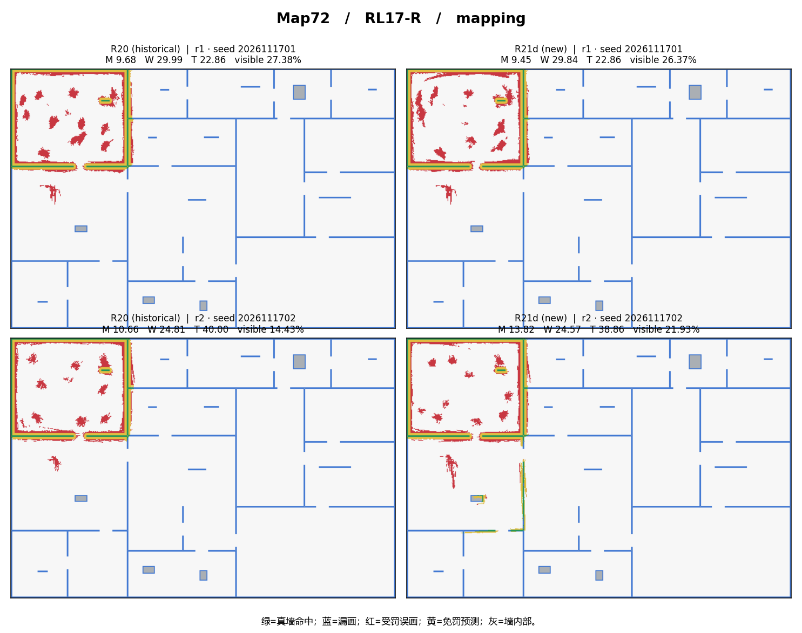
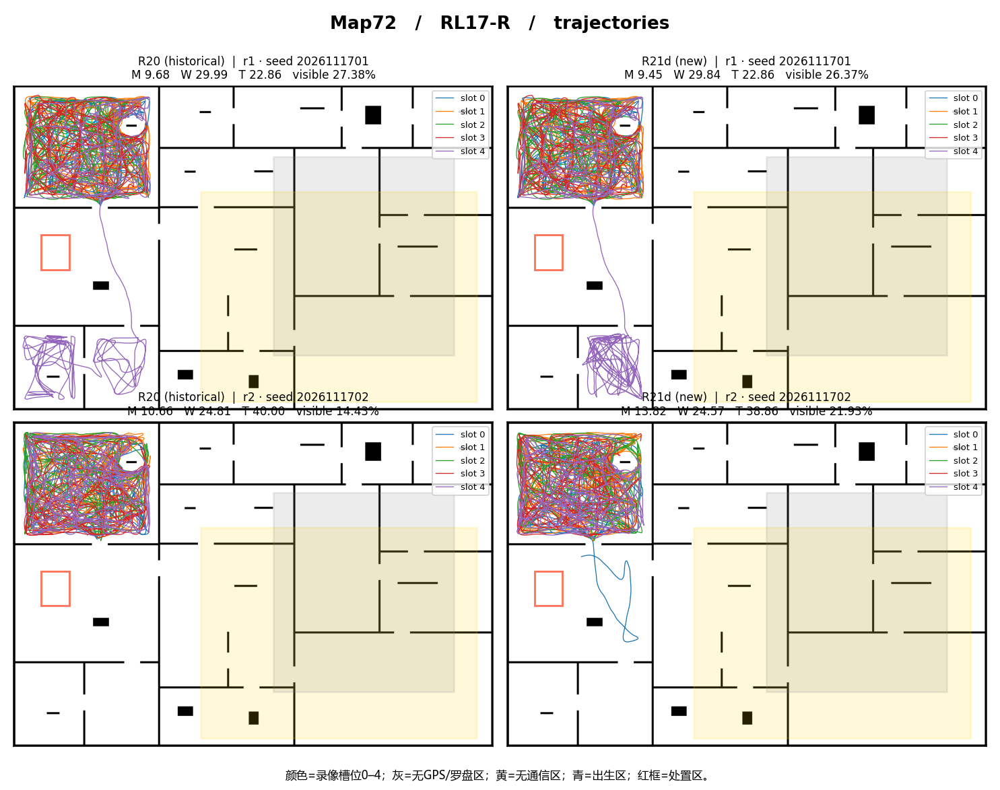
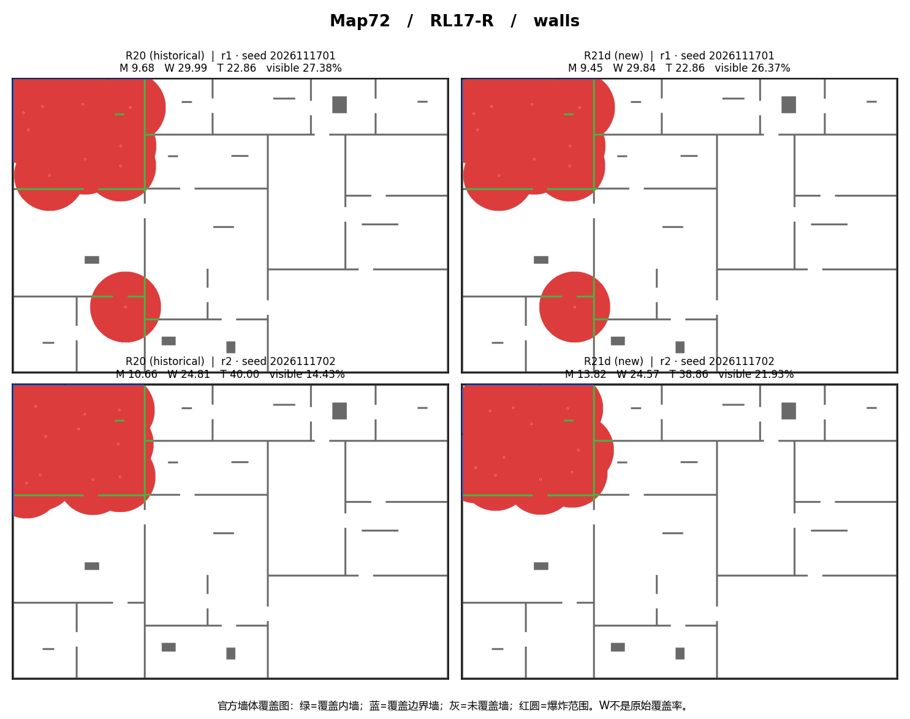
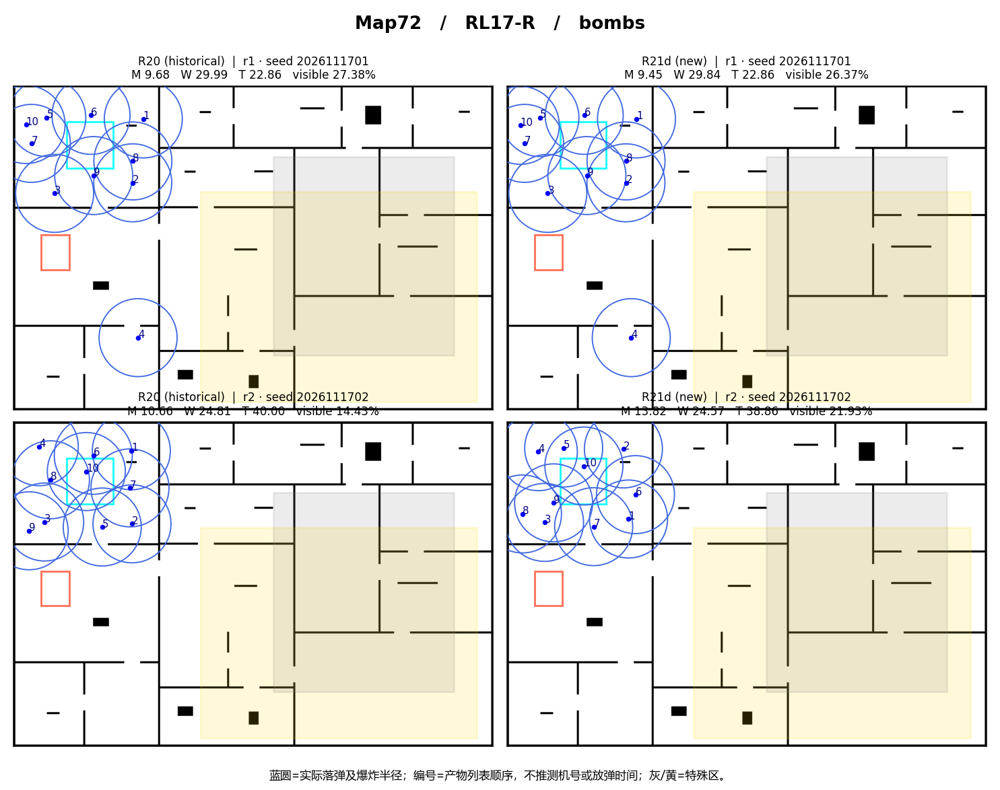

# R21d 历史回执与完成状态复核

历史 R21d 使用 RL17-R 完成了 6 局红阶段，每局有效、落弹 10 枚。Map72 两轮中，5 次任务选择了跨侧终点，录像在这 5 次任务期间记录的整机跨过对应入口次数为 0。本轮新增飞行 0 局，暂无新批量结果，暂无新评测图。下文图表来自历史批次 `r21d_20261118_095350_321` 及图中注明的历史 R20。

## 本次复核发现

Map72/r2 的三次修复都收到了位于入口另一侧的请求目标。下表按同一架飞机、同一回调步配对原始探测和执行记录，将机体系中的已记录点用对应步的仿真真值位姿转入世界坐标，再计算到历史 G01 截面的有符号垂距，单位 px。正值为任务开始的一侧，负值为另一侧。真值和入口标签只用于事后测量。[原始探测及修复请求](output/sf13/r21d_20261118_095350_321/runs/yh_map_fs_72_r02/rl17_repair/red/attempt_001/gate21_diagnostics.json) · [同一步的真值记录](output/sf13/r21d_20261118_095350_321/runs/yh_map_fs_72_r02/rl17_repair/red/attempt_001/gate21_diagnostics.npz) · [历史入口标注](output/sf13/r21_gate_prepare_20261117_184904/sections/yh_map_fs_72_r2_rl17_repair/analysis.json)

| 槽位 | 开始 → 修复 → completed（步） | 首次局部路径终点 | 修复请求目标 | 修复返回终点 | 退出时真实中心 | 任务内整机穿过 G01 |
|---:|---|---:|---:|---:|---:|---:|
| 3 | 285 → 296 → 297 | −44.51 | −44.26 | +43.51 | +44.07 | 0 |
| 2 | 539 → 554 → 555 | −50.50 | −55.76 | +12.16 | +12.62 | 0 |
| 1 | 1106 → 1133 → 1134 | −48.44 | −51.98 | +10.69 | +11.29 | 0 |

三例各有一次修复。返回后各余一个局部路点，下一回调该点分别距机身中心 0.77、0.47、0.52 px，路点队列清空并报 `completed`。这解释了三条**局部任务退出记录**。三段期间均无物理接触。任务窗口内分别有 2、2、3 次本机覆盖采样，新增格数 1,331、1,564、1,421。由于没有任务内跨口事件，跨后收益在三例均无观察值。[原始 RN7 事件](output/sf13/r21d_20261118_095350_321/runs/yh_map_fs_72_r02/rl17_repair/red/attempt_001/narrow_diagnostics.json) · [离线录像事件索引](output/sf13/r21d_review_20261118_095350_321/yh_map_fs_72_r2_events.json) · [路点耗尽时的退出条件](src/swarm_rescue/solutions/my_drone_red_rn7.py#L121)

**证据边界。** 修复调用仍收到对侧目标，现有证据将侧别变化定位在请求目标与实际返回路径之间。未执行路径当时能否全程安全、改动后是否会增加覆盖，均待验证。地图送达与定位保持独立。RX10 当时同时变更了任务及共享信息接收等行为；其 Map09 结果不足以判定单项机制的影响。R20-B 八组配对中五组覆盖回退，另有新增墙接触，历史上加大尝试预算没有稳定收益。R19 十二组配对里 RL17-R 相对 RL11 的地图分为 5 胜、5 平、2 负，继续将 RL17-R 作为暂定基线，保留 RL11 对照。[RX10 报告](复赛阶段_FS4_红队RX10_路口深入与自适应收尾_20261114.md) · [R20 报告](复赛阶段_R20_三版本配对结果与探索预算结论_20261117.md) · [R19 报告](复赛阶段_R19_配对红队与恢复权重结果核验_20261117.md)

## 工作区、工具与交接

开工时分支为 `main`，HEAD 为 `351f21fb7b031e7409f88e5ccaed1cd9293acc53`，相对本地 `origin/main` 领先 25 个提交。最近的前序提交为 `c77b9cb`、`aec5600`。当时工作树和暂存区均干净，只有一个登记的工作树，R21d 的进度文件记录 6/6 完成、无活动运行。沙箱可见的进程有限，其他编辑器未保存的缓冲内容无法核实。正式入口、现有包及本地参考对手的身份已分别记录。[对接文档与正式打包规范](复赛阶段_重新开始代码优化_对接文档.md)

历史实际控制器为 `MyDroneRedRepair17`，继承链通过 `MyDroneRedLines11` 使用 `MyDroneRedRN7B`。全局导航经 `NarrowMixin._navigation` 调用局部通行模块，局部退出原因来自 `PassageMotion`。原冻结清单 434 项解码后的字节、当前同路径的文件、六份运行收据的 162 项文件均通过 SHA256 比对。三张图用冻结地图 ID 回查 `dataset_001`，全部属于训练集，划分仍为 70/15/15。[历史冻结计划和完整哈希](output/sf13/r21d_20261118_095350_321/plan.json)

| 文件 | SHA256 |
|---|---|
| R21d 冻结计划 `plan.json` | `fa1e3103d4f854dcd7abb5d8acd2fbe728c6bb48c34b910eec34bf5176d4a2e7` |
| RL17-R · `my_drone_red_repair17.py` | `1785348ed19b2e9d68cbdbf59384746717cd2d38cdd3d5a57b35dfc31a730573` |
| RL11 · `my_drone_red_lines11.py` | `56474b5b14af1ce653060f8a082b4e24fdf44a5ded6a4dde7aa5e0415083bbf6` |
| RN7 · `my_drone_red_rn7.py` | `5f69845db141d0432d17e09e5c1ef2a5a995f5f8b261121de5f82373042e9be7` |
| Map72 · 地图 JSON | `07eef23002a7e5c5f77ade2eb4be2a333897f867a36a6a685ae8fb6ddd24f40d` |
| Map37 · 地图 JSON | `fc2c012d9ef26a94d0234056c2d1ceedf862414cec5314ec91edd6e366c8bfc8` |
| Map24 · 地图 JSON | `74268028a848381258210f9e0851558a07dcf39bdf8ef88aeb4ada30260be38e` |
| 本次离线工具 · `audit_r21d_receipts.py` | `18125a2759480e0e6e36d0eef3d25532fef17881e45fb9b6b242250714ad470a` |
| 本次测试 · `test_audit_r21d_receipts.py` | `d4c0c69075322c4bd99659e2a6955a80423429e400c1d5dab357107668353896` |

离线工具将原始 RN7 入场、修复、退出记录与历史离线物理穿越索引按机号和任务时间窗核对。每条任务分别输出退出原因、修复步、窗口内穿越次数及采样新增格。缺少采样时新增格为 `null`，有采样且未见新增时为 0。工具不重做录像几何判读，上表的有符号垂距是另行针对三次原始探测计算的。离线工具和测试均只使用 Python 标准库。[工具](src/swarm_rescue/solutions/devtools/audit_r21d_receipts.py) · [测试](src/swarm_rescue/solutions/devtools/test_audit_r21d_receipts.py)

**测试和冒烟。** 11 项离线确定性测试全部通过，包含修复后局部完成且零穿越、起止步归属、他机或任务外事件、无采样、受阻与抢占退出、收据缺失和矛盾。直接执行、包式 unittest 与 pytest 三个入口均通过。最终工具读取真实六局归档用时 0.71 秒，匹配 240 个任务，当前冻结路径差异 0，回执差异 0。六局原始结果的引擎回调异常计数均为 0。本轮在线行为、机身安全和比赛耗时没有新增飞行验收。首次离线冒烟的回执也单独保留。[最终离线核查收据](output/sf13/r21d_receipts_offline_o3yn68h8/audit.json) · [首次离线冒烟收据](output/sf13/r21d_receipts_offline_cgv45wja/audit.json)

从项目根目录运行以下 PowerShell 命令可**执行离线复核**，读取 6 个历史红阶段，新增飞行 0 局。每次独占新建 `output/sf13/r21d_receipts_offline_*/audit.json`。退出码配合 `errors`、`live_differences` 和逐轮记录读取；离线核查通过仅表示指定资料一致。

```powershell
.\.venv\Scripts\python.exe -B .\src\swarm_rescue\solutions\devtools\audit_r21d_receipts.py
```

**采用与未完成项。** 本轮交付历史核查工具与报告。在线载弹红队候选、真实飞行冒烟及 12 局配对筛选（2 个版本 × 3 张图 × 2 轮）均未实施，没有冻结计划、执行命令或待续跑批次。RL17-R 仍是研究基线。下一次交接从本报告及收据查起，采用决定需要同批次的新证据。

现有根目录包另以官方 `check_submission.sh` 静态核验通过，退出码 0，提示包内 16 处 `print()`。其红队工厂返回 RL17-R，蓝队分支显式抛错。检查前后包 SHA256 均为 `c07d210f0f92c57aaa8b318b8887cc5bc72c1d51a3cfdf7575fc959b55642f4c`。该结果仅针对已有文件，本轮没有包内飞行、打包或平台上传。[正式提交与打包规范及检查记录](复赛阶段_重新开始代码优化_对接文档.md#正式提交与打包规范)

## 六局历史成绩

三张图均属训练集。每图 r1 种子为 2026111701，r2 为 2026111702，实际特殊区均含无通信和无 GPS。六局控制器相同，蓝队难度分及完整比赛总分均未评测。M、W、T 分别为地图、墙体、时间分。覆盖按每 8 步、4 px 栅格估算团队雷达可见自由区，命中、漏画与受罚误画则根据实际提交图逐像素计数。[历史原始汇总](output/sf13/r21d_20261118_095350_321/summary.json)

| 地图/轮次 | 有效 | M / W / T | 真墙命中 / 漏画 / 受罚误画（px） | 采样覆盖 | 落弹 |
|---|---|---|---|---:|---:|
| Map72/r1 | 是 | 9.45 / 29.84 / 22.86 | 13,025 / 77,691 / 36,931 | 26.37% | 10 |
| Map72/r2 | 是 | 13.82 / 24.57 / 38.86 | 15,744 / 74,972 / 29,832 | 21.93% | 10 |
| Map37/r1 | 是 | 58.91 / 40.94 / 36.06 | 64,583 / 24,189 / 114,189 | 79.56% | 10 |
| Map37/r2 | 是 | 59.15 / 56.21 / 29.13 | 68,238 / 20,534 / 136,122 | 80.41% | 10 |
| Map24/r1 | 是 | 69.95 / 54.72 / 22.86 | 59,641 / 21,005 / 38,091 | 99.14% | 10 |
| Map24/r2 | 是 | 83.97 / 57.20 / 22.86 | 74,937 / 5,709 / 77,054 | 99.14% | 10 |

| 地图/轮次 | 完成步 | 卡住计数步 | 墙 / 机接触 | 引擎 / 进程（秒） | Job 峰值（MB） |
|---|---:|---:|---|---|---:|
| Map72/r1 | 4,536 | 540 | 0 / 29 | 134.71 / 146.70 | 846.12 |
| Map72/r2 | 3,931 | 120 | 0 / 20 | 122.61 / 131.69 | 817.95 |
| Map37/r1 | 4,037 | 660 | 0 / 2 | 139.45 / 155.28 | 843.24 |
| Map37/r2 | 4,299 | 480 | 0 / 1 | 133.71 / 142.20 | 855.37 |
| Map24/r1 | 4,536 | 420 | 0 / 2 | 139.72 / 148.97 | 843.71 |
| Map24/r2 | 4,536 | 600 | 0 / 0 | 137.68 / 146.47 | 830.64 |

冻结资源为单 CPU、4,000,000,000 字节、5,400 步或 180 秒，外层进程上限 240 秒。接触计数取引擎接触开始事件。历史核验综合结束记录、退出码、异常、回调、资源、弹数与评分重算判定有效。[历史有效性回执](output/sf13/r21d_review_20261118_095350_321/audit.json)

## 一次探测、一个任务、一次穿越各记什么

首次调用统计实际尝试建立 RN7 任务的调用，修复调用发生在执行期间。附近首次调用按 150 px 范围筛选，每个调用可能对应多个离线标签入口。“有跨侧路径”按调用与标签入口配对计数，要求存在至少一条满足快照检验的候选。“任务内过对应口”按配对记有无，“全程 / 任务内”按实际整机穿越事件逐次记，往返可重复计数。这几列分母不同。[历史逐机与逐任务明细](output/sf13/r21d_review_20261118_095350_321/逐机与任务明细.md)

| 地图/轮次 | 首次 / 修复调用 | 附近首次 | 调用×入口 | 原始可达、膨胀后不可达 | 有跨侧路径 / 实选跨侧 | 任务内过对应口（配对数） | 全程 / 任务内（事件数） |
|---|---|---:|---:|---:|---|---:|---|
| Map72/r1 | 73 / 18 | 17 | 17 | 16 | 3 / 2 | 0 | 2 / 0 |
| Map72/r2 | 86 / 14 | 13 | 13 | 13 | 5 / 3 | 0 | 1 / 0 |
| Map37/r1 | 112 / 28 | 32 | 40 | 9 | 15 / 7 | 6 | 31 / 6 |
| Map37/r2 | 124 / 22 | 29 | 33 | 4 | 7 / 2 | 0 | 37 / 0 |
| Map24/r1 | 83 / 22 | 32 | 35 | 0 | 18 / 10 | 10 | 107 / 10 |
| Map24/r2 | 69 / 18 | 29 | 32 | 0 | 15 / 6 | 6 | 93 / 6 |

每局建立了 40 个任务。下表汇总 6 个历史 `*_events.json` 的 `tasks` 与 `crosses`。任务新增格为本机按 8 步采样累计的新见 4 px 格，以采样时刻归属任务，多机之间可能重叠。“200 步内反穿”计数以起始穿越事件为单位，要求同机反向穿过同一标签入口；任务内一列仅要求起始事件在任务内。最后两列分别描述任务期观测和有限窗口内的回穿，无法一并解释为整机进入后在另一侧的停留时长或团队新增覆盖。

| 地图/轮次 | 报 completed 的任务 | 无采样 / 有采样且零新增的任务 | 任务期本机新增格之和 | 200 步内反穿，全程 / 任务内 |
|---|---:|---|---:|---|
| Map72/r1 | 30 | 4 / 18 | 6,221 | 0 / 0 |
| Map72/r2 | 34 | 1 / 22 | 5,680 | 0 / 0 |
| Map37/r1 | 35 | 3 / 6 | 18,560 | 4 / 0 |
| Map37/r2 | 36 | 1 / 6 | 20,834 | 7 / 0 |
| Map24/r1 | 36 | 0 / 5 | 26,331 | 32 / 4 |
| Map24/r2 | 39 | 1 / 4 | 30,405 | 23 / 0 |

Map72 两轮实际整机穿越均发生于 RN7 任务之外。r1 两个实际选中跨侧终点的任务因新扫描受阻而退出；r2 三个任务有路线修复，退出原因为 `completed`。其余三次有跨侧候选的快照选择了同侧或深度不足的终点。六局 240 个任务中仅 1 个以 `no_progress` 退出，任务超时为 0。Map72 缺少任务内穿越样本，其任务内跨后新增覆盖及停留时长填“不适用”；其余有任务内穿越的局，原有任务汇总未单列跨后新增覆盖及连续停留时长。[历史入口诊断与证据边界](复赛阶段_R21d_RL17-R六局入口与地图送达诊断_20261118.md)

## 地图送达

六局提交者均为 0 号机。按其实际持有的来源版本重建，六张提交图均逐像素吻合。年龄以提交时的步号减来源版本的步号。[逐机本地图、收到版本和时间记录](output/sf13/r21d_review_20261118_095350_321/run_details.json)

| 地图/轮次 | 提交步 | 提交者持有的来源版本（依次 0 / 1 / 2 / 3 / 4） | 最旧年龄（步） |
|---|---:|---|---:|
| Map72/r1 | 4,535 | 4535 / 4530 / 4500 / 4500 / 2670 | 1,865 |
| Map72/r2 | 3,930 | 3930 / 3920 / 3900 / 3870 / 3900 | 60 |
| Map37/r1 | 4,036 | 4036 / 4000 / 4020 / 4020 / 4020 | 36 |
| Map37/r2 | 4,298 | 4298 / 4290 / 4290 / 4260 / 4260 | 38 |
| Map24/r1 | 4,535 | 4535 / 330 / 570 / 1380 / 30 | 4,505 |
| Map24/r2 | 4,535 | 4535 / 4530 / 3690 / 4500 / 4500 | 845 |

Map24/r1 的 4 号机本机终图命中 31,215 个真墙像素，提交者持有的来源版本 30 命中 96 个。对照同图 r2，二者团队覆盖均为 99.14%，最终命中数相差 15,296 个像素。各来源地图彼此重叠，单来源命中差不可相加推算总失分。

## 历史图示与回放

以下均为 **Map72、RL17-R 的历史图**。左列为历史 R20，右列为历史 R21d；上排 r1（2026111701），下排 r2（2026111702）。两轮 R21d 分别运行 4,536 和 3,931 步，与 R20 同轮分别相差 0 和 +43 步。R21d 涉及额外诊断开销，两个历史批次间的差异不能直接归因于策略收益。Map37/r1、r2 对应步数差 −499、−237，Map24/r1、r2 对应 +271、0。整套历史 15 张 PNG 均可解码，大小均为 1485 × 1174，SHA256 全部与历史清单一致。[历史图件 SHA256](output/sf13/r21d_review_20261118_095350_321/figures.json)

**探索覆盖**。浅绿为 8 步 / 4 px 采样的团队雷达可见自由区，黑色为真墙；右列分别为 26.37%、21.93%。



**提交地图**。绿色为真墙命中，蓝色为漏画，红色为受罚误画，黄色为免罚预测，灰色为墙内部。



**实际轨迹**。五种轨迹颜色为录像槽位 0–4，灰色为无 GPS / 罗盘区，黄色为无通信区，青色为出生区，红框为处置区。



**墙体得分图**。绿、蓝分别表示覆盖到的内墙和边界墙，灰色为未覆盖墙体，红圆为仿真作用范围。



**仿真炸弹位置**。蓝圈标出实际落点和仿真作用半径，编号为产物列表顺序，灰、黄为特殊区。



三张地图、两轮各自的五类图和逐局完整红阶段回放命令，见原历史报告的“六局图册与录像”。六局均只运行红阶段。[历史六局图册和回放命令](复赛阶段_R21d_RL17-R六局入口与地图送达诊断_20261118.md#六局图册与录像)
