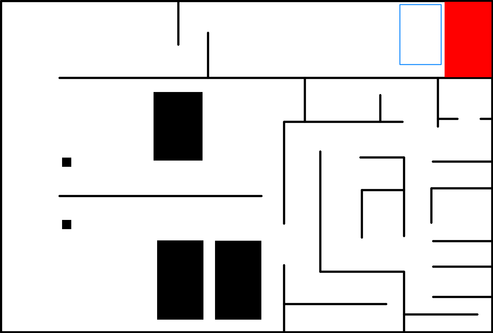

> 2026-11-10 执行更新（覆盖下方旧状态）：仓库已到6557940；初赛用户生成图及关联数据已按清单删除，复赛生成器和单张预览已完成。完整状态、最新命令及后续R0—R5见 [复赛阶段_地图生成器更新与后续实施方案.md](复赛阶段_地图生成器更新与后续实施方案.md)。旧dataset_001/batch_001不可续跑；正式复赛评测尚待R0适配。
# 复赛阶段：规则适配、平台地图与布弹优化规划

日期：2026-11-10。当前仓库提交：`058c3ff`，上一阶段提交：`09562a9`。

## 一、本次范围与结论

本次按用户最新要求只做代码/数据只读审计和规划，不修改Python、评测配置、地图文件或提交包，不启动仿真、生成地图、参数搜索。只新增本规划，更新交接/开发总览，并将新平台包内4张原始评分图复制到 `output/semifinal_planning_20261110/` 供查阅。ZIP原件未变。

核心结论：

1. 复赛是一组规则变化，不能只做此前讨论的语义噪声适配。首先修正量程假设、特殊区域和评测条件，再讨论布弹收益。
2. 新增初赛平台结果最终分57.63，实际布局标识为Map07t4；它的官方JSON、PNG、地图类、墙体文件和launcher注册已经随新仓库提交到位。需要补的是开发评测/数据集地图目录，不应重复制造一张近似图。
3. 新平台两轮都放满10颗。第二轮墙体分增加15.34、难度分下降19.26，最终分反而略降。后续必须联合评价墙体边际覆盖与蓝队处置难度。
4. 现有生成器只对少量外形统计作校准，布局机制仍以BSP房间分割为主；与平台地图的开放大厅、长隔墙、局部密集房间、厚实体和特殊区域分布存在差异。应更新结构生成机制和校准协议，不能只提高墙数量。
5. 初赛进阶2仍冻结保留。此前“可以继续用”的判断针对旧语义噪声修正；不能延伸成“无需改动即可适配本次复赛规则”。此次并未实施此前提出的噪声候选。

## 二、已证实的仓库变化

依据 [官方复赛说明](doc/复赛调整说明.md) 及 `git diff 09562a9 058c3ff`：

|变化|初赛值→复赛值|策略含义|
|---|---|---|
|语义识别量程|200→130像素|更晚识别炸弹、队友、处置中心；130～230范围内的激光回波没有同等范围语义辅助|
|激光量程|300→230像素|必须同步调整未命中判断、自由空间更新、墙体拟合和探索障碍记录|
|通信半径|250→180像素|地图快照、布弹认领、库存确认更容易延迟或中断|
|初始健康|50→25|碰撞和强制脱困的成本更高；必须记录失活与失活前库存|
|红蓝时间满分线|时限的0.5→0.3|同样结束时间的分项会变；旧成绩不能直接套用|
|默认评测地图|Map01→Map06|不能仍以旧Map01配置代表默认复赛环境|
|默认特殊区域|空列表→NO_COM_ZONE、NO_GPS_ZONE|必须检查实际地图实例创建的区域，而非只看配置字符串|

此提交未再次修改语义噪声分布代码；此前修正仍为零均值、距离标准差2.5。缩短量程与改变噪声分布是不同问题。

新地图/区域实际状态：

|地图|尺寸|时限（步/秒）|原生代码实际区域|
|---|---|---|---|
|Map06|1700×1100|5400/180|1个无通信区|
|Map07t4|1660×1122|5400/180|无特殊区域|
|Map08|1660×1122|5400/180|2个无GPS区|
|Map09|1700×1100|5400/180|1个无通信区、1个无GPS区|

**NoGpsZone同时禁用GPS和罗盘。** 不能设计成“GPS失效但罗盘始终可用”的定位方案。Map06虽在评测计划中同时配置两类区域，地图本身目前只创建无通信区；Map08只创建无GPS区，Map09才同时创建两类。

默认红队5机、每机2颗；默认蓝队10机。现有本地红蓝工具复用了同一个drones数，历史5机蓝队参照不等价于复赛默认10机蓝队。平台实际参考蓝队阵容/数量仍以平台说明为准，不能把本地设置当作平台事实。

时间曲线由原评分器计算。例如结束比例0.84时，时间分从32降至约22.86；总分中时间权重0.1，对应约0.91分差。这只是同轨迹的评分示例，不是复赛成绩预测。

## 三、初赛新增平台结果：57.63分从哪里来

源包：[evaluation_result(进阶2 57分).zip](<平台评测结果/evaluation_result(进阶2 57分).zip>)。

包内标识 `20261104_742_team742_preliminary`，最终分57.63，名次65，2轮。用户将其标为进阶2；附件没有提供足以独立核对提交控制器全文的源码哈希，策略身份按用户说明记录，不擅自把本地现有742包当作该次上传包。

结果表的“地图”列写Map01，但炸弹JSON的 `map_name`、附件名均是Map07t4，评分真值图也呈现该地图布局。后续按真实附件身份建档，并用原生墙掩码重算墙体分完成精确几何验收；本次未执行重算。不能按结果表的Map01字段导错地图。

|轮次|地图分|墙体分|时间分|校准难度分|完整分|放弹|墙钟秒|
|---|---:|---:|---:|---:|---:|---:|---:|
|1|80.12|35.80|32.00|36.08|57.63|10|90.8|
|2|80.22|51.14|37.52|16.82|57.45|10|90.1|

包内EVALUATION.md明确该次最终分取两轮最高值，不是均分；两轮算术平均57.54只能作稳定性描述。复赛平台是否继续沿用同样聚合，需以复赛发布说明核实，不把初赛规则直接外推。

第二轮相对第一轮，按分项权重计算：

|分项变化|对总分的贡献|
|---|---:|
|地图+0.10|+0.050|
|墙体+15.34|+3.068|
|时间+5.52|+0.552|
|难度−19.26|−3.852|
|合计|−0.182（与展示总分−0.18一致，存在小数舍入）|

**已证实：** 墙体提高并没有转化成总分提高；地图分两轮都约80，放满弹也不等于布弹任务收益充足。第一轮相对100分的缺口，地图约9.94、墙体12.84、时间6.80、难度12.78个总分点，不能只盯墙体。

**图件观察：** 第一轮提交对比图中，右下部细墙、下部边界和部分实体边缘有明显缺失；并非所有区域都没探索。第二轮布弹覆盖主要落在左侧/中部实体与长隔墙周围，右侧房间区域覆盖较少；部分爆炸圆相交。圆相交不等于墙体收益重复，需按实际墙像素并集量化。

**推测，尚未验证：** 路线/信息融合不足可能导致地图缺墙；偏向厚实体和较开放区域的布弹可能便于部分蓝队搜寻与搬运。还不能断言是选点权重、任务覆盖、通信、噪声或单个蓝队造成难度下降。匿名5组蓝队热图可用于离线比较覆盖/往返路径，但并不能单独恢复完整处置时间和所有蓝队逻辑。

[第一轮布弹与墙体图](output/semifinal_planning_20261110/team742_Map07t4_none_rd1_wall_destruction.png) · [第二轮地图图](output/semifinal_planning_20261110/team742_Map07t4_none_rd2_exploration_diff.png)

其他平台包只作历史归档：旧进阶2Map07最终70.39、窄路版Map07最终69.65，最早62.1包的炸弹附件为Map01。本次57.63对应Map07t4，不能解释成同图同种子退步12.76分，更不能归因为后来才拉取的复赛规则。

## 四、平台地图怎样加入地图目录

### 4.1 已有文件，无需重复导入

目前平台附件涉及的Map01、Map07、Map07t4均已有原生地图。新增Map07t4四件套：

- `map_data/map_07t4.json`、`map_data/map_07t4.png`。
- `src/swarm_rescue/maps/map_07t4.py`、`walls_07t4.py`。
- `src/swarm_rescue/launcher.py`已经注册Map07t4，也已注册Map06、08、09。

这些是用户pull下来的官方文件，本轮不改动。现有开发工具 `evaluate_red.MAPS` 还仅列01、02、03、04、05、07，`evaluation_config()`仍硬编码空区域；因此“官方已加入”不等于“我们的批量工具已经可测”。

### 4.2 待实施的目录与来源清单

在solutions内新增/扩展地图注册与数据目录适配，记录官方类名、编辑器JSON/PNG、几何哈希、出生区/中心、规则版本、实际区域、来源评测包与评分图链接。既有官方地图只引用，不复制成不同身份；未来确实缺失的地图Python仅写在solutions内，按子进程注册接入。

地图命名保留Map07t4，不能改名冒充Map07。用户生成图仍为 `map_01_yh` 顺序追加，保存JSON/PNG到map_data；来源、种子、生成算法和校准版本写旁路记录，不覆盖已有100图和dataset_001。

### 4.3 几何相似与防泄漏

已逐元素比对：Map07t4与Map08的line_wall/rect_wall JSON完全相同，Map08增加两个无GPS区。应视为同几何族、不同规则场景；不能一个放训练集、另一个当独立几何泛化测试。只在专门的区域干预实验里使用这对场景，并显式标注几何复用。

所有几何旋转/镜像、门位置小扰动、同源种子变体分组划分；版本信息包含校准清单哈希。已公开且已分析的平台图属于已知诊断集，不再冒充盲测测试集。

### 4.4 地图接入验收

1. JSON、PNG和原生实例的尺寸、墙体、出生区、中心及区域一致。
2. 复载两轮平台布局，以相同评分参数重算墙体分，与平台展示值在舍入精度内一致；差异超过0.02分必须查清，不能先作为精确复刻使用。
3. 每图可单独回放，完整命令记录到报告；Map07t4不能用Map07类播放。
4. 无通信区和无GPS/罗盘区的实际设备失效经过少量接口检查验证，不能仅检查图片有色框。

## 五、自动生成地图为什么不像，以及更新方向

### 5.1 可核对的结构差异

下表统计编辑器元素，line_wall数量含边界，不能直接解释成房间数：

|地图|尺寸|线墙数|实体矩形数|特殊区|
|---|---|---:|---:|---|
|Map07|1660×1122|60|5|无|
|Map07t4|1660×1122|31|5|无|
|Map06|1700×1100|73|20|无通信1|
|Map08|1660×1122|31|5|无GPS2|
|Map09|1700×1100|93|5|无通信1、无GPS1|
|现有生成样例map_25_yh|1200×900|32|6|无|

以上线墙厚度均为6像素。问题不是简单的墙厚，而是布局组织与尺度：

- Map07t4是大开放区、几条长隔墙、局部房间和大型厚实体混合；Map06具有开放区中的柱阵和局部密集结构；Map09有连续走廊、重复房间和不均匀密度。
- 旧默认生成器固定1200×900、hard，主要通过递归切分房间加门/额外开口实现；很难仅靠墙段数和面积比例匹配上述结构。
- 原生生成图固定5机、5000步/180秒且拒绝特殊区，无法承载复赛10机蓝队、5400步参考场景和传感器失效区域。
- 当前 `official_profile.read_profiles()`自动扫描 `map_[0-9]+.json`。此次pull会自动纳入06/08/09，**却排除07t4**；既有种子会受校准池改变影响，不能只记seed声称可复现。其现有统计也不包含特殊区域。
- Map07t4和Map08若以后都进入校准池但不去重，会重复加权同一几何。

### 5.2 拟采用的生成流程

先抽取冻结的几何统计，再生成“开放区域与房间的连接图”，之后落成墙体；保留BSP作为一个结构族，而不是全部默认样本。

拟覆盖：开放大厅+局部房间、长走廊+重复侧室、折线隔墙+多通道、厚实体+柱阵、疏密混合、狭窄门口/长绕行等结构。每类独立控制开放面积、房间尺寸分布、死路比例、连接环数量、门宽、长墙比例、实体长宽与分布、出生区到中心/高价值墙区的可达距离。

尺寸从参考分布抽样，含1660×1122、1700×1100及已有其他尺寸；不通过把所有坐标等比缩小来代替真实尺度。感知230、通信180和爆炸半径与地图尺度之间的关系属于困难度因素。

特殊区采用独立场景层：无区域、仅通信、仅定位、两者同时；区域可以覆盖交通瓶颈、远端任务区或形成重叠，必须验证出生、可达性及退出机会。NoGps场景须同时考虑罗盘失效。先以几何为单位划分，再分配区域变体。

输出维持用户认可的一条数量命令；具体默认混合比例在预览验收后冻结，不要求用户每次输入大量参数。每图保存算法版本、参考清单哈希、种子、规则档、结构族、区域和验收指标；旧图和旧清单原样保留。

### 5.3 生成器验收标准

- 先给各结构族少量缩略图和统计，由用户确认布局风格；助手不自动生成新大数据集。
- 原生实例复载、净空、出生布局、边界、连通性与可退出区域检查通过。
- 墙厚/长墙/实体尺寸、开放度、门宽、路线绕行比、出生位置和区域覆盖率均输出分布对照；不能只凭一张“像”的图片验收。
- 拟采用分位区间和参考图留一检验评估结构覆盖；阈值在看统计后冻结，不能凭目前少数图宣称拟合了真实盲测分布。
- 同源/近似几何不跨训练验证测试；重复图与不可达图拒收，失败原因留存。

## 六、复赛实施顺序、修改范围与验收门槛

以下均为待确认方案，本次不实施。

|阶段/优先级|内容与允许修改范围|验收标准|
|---|---|---|
|R0 最高|solutions/devtools内补规则档、官方地图目录、独立红蓝机数、区域和时限参数；冻结旧批|能列出10张官方图01～09及07t4；实际运行参数与官方规则一致；旧引擎批次拒绝混分/续跑；特殊区不被静默清空|
|R1 最高|独立进阶2复赛适配候选，保留原文件；修正量程/未命中语义、定位失效/恢复、通信过期、低血量行为|新旧量程的无命中射线不能生成虚假墙环；有效墙回波不被一概丢掉；无GPS/罗盘时能预测并安全降级；恢复不跳变污染地图；断联后不依据旧认领永久等待|
|R2 高|平台Map07t4档案与官方01～09、07t4诊断报告；只读平台热图/布局归因|每轮分项、墙体新增/重复覆盖、五机投弹时间、轨迹、图件和完整回放命令；缺数据明确列出；同批全体统计，不拼最优轮|
|R3 高|生成器及数据管理适配，Python仅solutions内|上述结构/区域验收通过，保留原100图；用户确认预览后自行生成和冻结新清单|
|R4 高|独立布弹候选：边际收益、选点搜索、难度代理、通信下认领和末枚释放|同图同种子下完整分改善；地图分、放满率、生存和提交率无明显退化；墙体改善不能以难度大幅下降交换；证据不足保留候选|
|R5 后续|冻结后参数搜索、困难样本、完整对照，承接原G4及以后|用户启动正式批；验证集选型、最终测试集只验收；报告均分/P10/方差/失败率及平台风格分组；之后才讨论team742_semifinal打包|

R0与地图身份核对是所有后续工作的前提；R1不依赖大规模生成，可先做。R2的失分诊断指导R3结构分布和R4候选设计。未经规则适配，直接自动调参可能学会补偿虚假墙和错误蓝队配置，应停止沿旧流程盲目推进G4。

### R1必须解决的具体适配风险

进阶2 `_M01_ObservationMap.observe`、`_M03_fit_scan`仍默认 `max_range=300`，生效的探索网格 `_M09_ExplorationGrid.observe`仍用 `d<290` 标记命中。调用处没有传入复赛230量程。原生射线无命中返回最大量程，再叠加噪声；因此230附近读数会满足旧阈值，存在确定的判断逻辑不匹配，可能在空旷处累积假墙。实际比赛失分幅度待验证。

适配应从公开传感器规格统一传递量程和噪声容差，分别处理有效命中、量程边缘和无效读数；不凭观测最大值随时猜量程，不读取隐藏真值。不能只替换一个300而遗漏探索栅格、拟合、自由空间采样等路径。

语义量程比激光短，远端动态物体无法被语义确认，墙体入图应依据重复/空间一致性控制，不得把全部未识别回波当作静态墙或全部忽略。现有定位已融合里程计，但没有完整不确定性管理；失去GPS/罗盘时不能盲目持续高置信地图写入。通信中断时需本机安全完成任务、有限认领有效期、重联后版本化地图合并及库存核验。

### R4布弹优化方向

1. **先记录漏选原因。** 将“没观测到高价值墙”“不可达”“候选未入围”“距离折扣淘汰”“已被认领”“到达时失去收益”分开，不能看到真值好位置就认为在线算法当时应该知道。
2. **按新增墙体并集评分。** 分别计算同机/跨机重复，认领只作有时效的预测覆盖；实弹确认后才转为已占收益。圆形范围交叠不是唯一拒绝条件。
3. **修正厚墙与薄墙的候选偏置。** 在合法观测内估计墙面/实体收益与置信度；验证骨架面积、距离折扣及前六候选筛选是否过早淘汰高收益点。未知厚实体不能由离线真值补给在线策略。
4. **难度采用路线代理。** 考虑到已观测中心的可达运输路长、绕行、区域覆盖和搜索分散，而非仅用欧氏距离。地图未充分探索时记录置信度，避免为一个高估难度点付出长途成本。
5. **以总收益决定任务持续/改派。** 比较继续原任务剩余收益与改派收益，扣除新增路程、风险、信息过期和任务切换损耗；已有有效推进时设置改派滞回，避免频繁换目标。
6. **末枚保底也要检查收益。** 当前常规布弹收益检查受0.68进度门限影响，后期可能绕开；设计有界末枚搜索与明确的时间/库存兜底。不能简单禁止低收益弹而导致大量未放满。
7. **蓝队难度用多种行为验证。** 先修正官方10机基准及区域，再决定是否增加独立运输/搜索参照蓝队；不能为了让红队分高而削弱蓝队，也不将一个本地蓝队高分当作平台90分保证。

## 七、评测和采用纪律

初赛历史档与复赛档独立：记录commit、完整源码哈希、地图/区域、量程/血量、时间曲线、红蓝机数、实际蓝队身份、种子和资源条件。已有4GB/单CPU压力条件继续作为本地参考，复赛平台是否同样硬件/内存需要官方确认；不声称模拟了Xeon实际速度。

诊断先选03/07/07t4以及06/08/09的代表场景，旧01/02/04/05作为回归组，按阶段小批验证；不得按地图名称写在线特例。正式阶段全10张公开图各3轮、基线和候选同种子配对是建议矩阵，实际由用户确认并启动。区域开关消融单列，不与主成绩混算；不把初赛的已知公开图称为独立盲测。

本地评估同时报告有效完整均分、失败率、P10、分项、种子稳定性；平台排行榜若取最高轮，则另列该口径，不能在本地只挑最佳轮。成功采用须跨地图而非单张提分；建议预注册总分提升目标至少1分、地图均分下降不超过0.5分、放满/提交成功率不下降，最终阈值需结合基线方差确认，不能把小样本阈值等同统计显著。

每阶段保留逐图逐轮地图分、墙体分、时间分、校准难度与总分、五机弹数、失活/碰撞、提交与末弹时刻、地图/墙体/布弹/轨迹图、日志和**实际已验证的完整回放命令**。本次尚未解包录像或跑复赛，因此不编造新的回放路径和评测成绩。

所有Python仅允许在 `src/swarm_rescue/solutions/`；原项目、上游地图、用户文件、平台ZIP及当前提交包全部保留。新候选未胜出不替换默认入口。复赛包最终拟名 `team742_semifinal.zip`，实施前核对对应赛段命名规则；本次不打包。

## 八、本轮交付与下一步

本轮完成：新提交审计、平台三份ZIP分项读取、新平台图件检查、地图身份/现有四件套核查、Map07t4与Map08几何同族验证、旧工具和生成器差距分析及本规划。

未完成且未启动：规则适配代码、平台墙体分精确复算、开发地图目录接入、生成器重写、红蓝仿真及新策略优化。确认后先实施R0，再按R1～R5逐阶段交付。

原进阶2SHA256：`5B1FD0E26F585923F0D4FB220A006ED6CB8258C4D94C1876A45A450E45B053D0`；现有team742_preliminary.zip：`111ED7B00582EA009742E2A2BD6A6C2710241663B1354DF3699AA930426AB949`，本轮均未改变。

