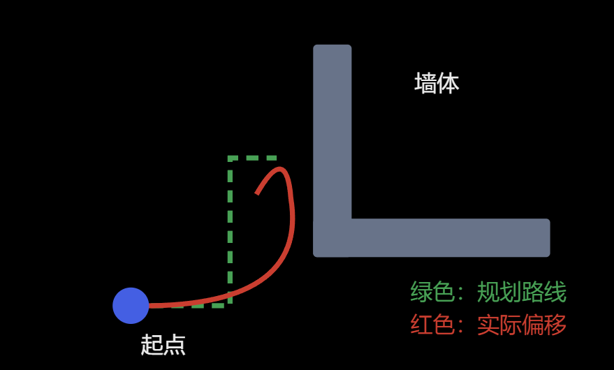
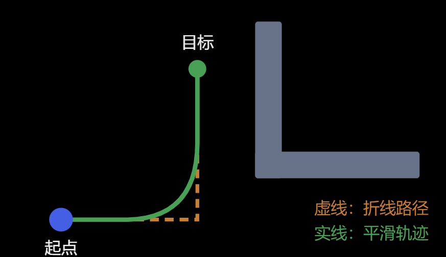
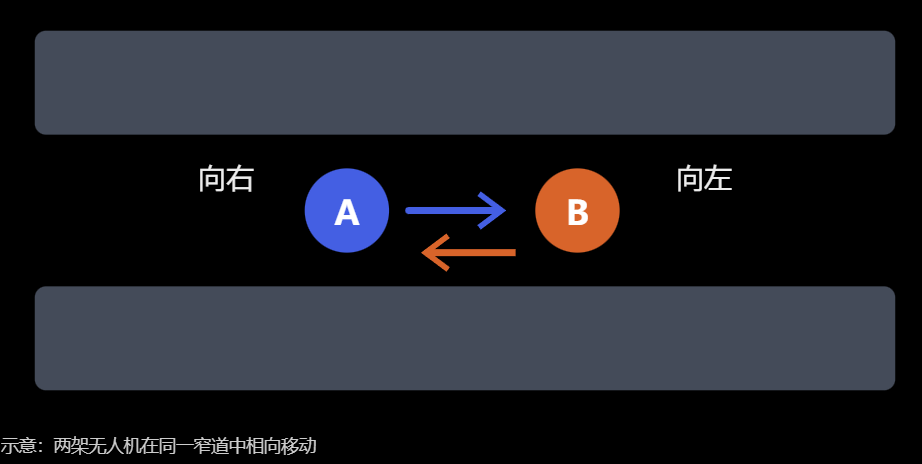

# 尝试进阶4阶段问题

## 1.无人机协同问题

协同完全没有达成目的，感觉这个协同完成不好

## 2.窄路通过问题

窄路通过有改善，但是好慢，为什么不能直接中心通过就行，不用停那么久，或者那么慢，窄路通过要补充优化到进阶5

## 3.徘徊问题相当严重

下面是我查找出的问题和解决办法，你详细分析然后给我最新的进阶5策略（采用最好一版更新进阶5）

# 无人机徘徊循环问题*

### 一. **<u>导航和避障控制的冲突</u>**

#### 原因

1.导航判断能通过，不代表无人机按照实际动力学一定能顺利通过。(也就是在实际动力学情况下导致这个问题) **<u>导航和避障控制的冲突</u>**

eg:



#### 优化方向：（解决徘徊问题）

1.导航不仅规划一条能走的路线，还要结合无人机的速度、加速度、惯性和转弯能力，计算如何沿路线运动。



#### 方案：

##### 1.根据动力学计算安全速度

$$
d_{\text{stop}} = \frac{v^2}{2a}
$$

这意味着速度越快，制动距离越长。

例如：

- 速度为 4 像素/步，减速度为 1 像素/步²，理想制动距离约 8 像素。
- 速度为 8 像素/步，在相同减速度下，理想制动距离约 32 像素。

这些只是简化模型示例，并非你们仿真器已经确认的参数。

##### 2.根据路线提前调整速度

- 不再等无人机到达拐点才减速，而是提前计算：
- 直线宽阔区域：允许较高速度。
- 接近拐点：逐渐减速。
- 狭窄通道：限制速度和横向偏移。
- 接近布弹目标：提前制动，保证落点精度。

##### 3. 根据实际状态不断重新计算

每个时间步重新读取无人机状态，预测未来一小段时间的运动，再选择合适的控制指令。

这种思路可以进一步采用模型预测控制（MPC）。

- 读取当前位置、朝向和速度
- 结合地图和动力学预测未来轨迹
- 检查轨迹是否碰墙、是否偏离路线
- 选择安全且推进效率较高的控制指令
- 执行一个时间步，再重新预测


##### 修改策略（判断是否可行）

保留现有全局路径规划，增加一个考虑动力学约束的局部轨迹规划器。

全局规划负责找路，局部规划负责根据速度、惯性、墙体距离计算未来几步怎样安全通过。


### 二. 导航机制

有风险已经解决部分，可能仍存在

当地图更新导航更新那么也会导致重复选之前位置

1. 重新经过以前的位置：不一定有问题。例如发现新墙体后，导航重新规划，可能需要沿原路返回，再进入另一条通道。（没问题）
2. **<u>反复选择已经探索过、没有新增收益的位置：这才是我们需要避免的无效循环。</u>（需要解决）****

### 三. 多机相互影响

两架无人机都想通过同一条狭窄通道，互相阻挡。

#### 1.狭窄通道互相阻挡



#### 2.多架无人机争抢同一个出口

假设五架无人机从同一个出生区域出发，而已知地图中只有一个出口。

```
无人机 A ──┐
无人机 B ──┤
无人机 C ──┼──→ 唯一出口 ──→ 未知区域
无人机 D ──┤
无人机 E ──┘
```

每架无人机单独规划时，都会认为这个出口是正确选择。

但同时接近出口，可能造成：

- 后方无人机被前方无人机挡住。
- 后方无人机尝试绕行，却没有足够空间。
- 前方无人机调整方向时影响后方。
- 多架无人机不断减速、避让，降低整体探索效率。

进阶4方案明确提出了领机推进、后机保持间距、有序通过，但属于待开发方案，不能当作现有功能。

#### 3.两架无人机同时选择同一个探索目标

这属于任务决策冲突。

例如：

```
无人机 A ───┐
            ├──→ 探索目标 P
无人机 B ───┘
```

两架无人机都认为 P 附近有很多未知区域，因此都前往 P。

结果可能是：

- 两架无人机重复扫描同一片区域。
- 接近目标时互相避让。
- 一架无人机先完成探索，另一架还在前往已经失去价值的目标。

现有策略会根据收到的队友目标信息降低附近候选的吸引力，但因为通信范围有限、信息可能延迟，无法保证完全避免。

#### 4.互相避让造成连锁反应

不一定需要狭窄通道。

例如，三架无人机同时运动：

```
A → B → C
```

B 为了避让 C 而减速，A 发现 B 减速后也开始避让。

随后 C 改变方向，B 又恢复前进，A 再次调整。

这时即使每架无人机的局部避障逻辑都是合理的，整体仍可能出现频繁加减速和方向变化。

这属于多个独立控制器之间的相互耦合。

#### 5.通信信息不一致

现在的无人机不是始终共享一份完全同步的全局地图，而是通过有限范围通信交换信息。

因此可能出现：

- A 已经发现某条路不通，B 还不知道。
- A 已经探索完一个区域，B 仍把它当作高价值目标。
- A 正在执行某项任务，B 没有及时收到目标信息。

这种情况不一定直接造成碰撞，但可能导致重复探索、目标冲突和不必要的往返。

#### **目前功能（进阶2阶段）**

| 功能                   | 是否实现 | 作用                                 |
| ---------------------- | -------- | ------------------------------------ |
| LiDAR 障碍检测         | 已实现   | 检测周围墙体和障碍物                 |
| 局部避障控制           | 已实现   | 根据障碍物位置调整飞行方向           |
| 速度反馈与主动制动     | 已实现   | 减少惯性导致的过冲和反复摆动         |
| 已知地图路径规划       | 已实现   | 根据已知可通行区域规划路线           |
| 障碍物安全膨胀         | 已实现   | 避免规划路线过于靠近墙体             |
| 路径前视与路点跳过     | 已实现   | 减少不必要的转向，提高路径跟踪效率   |
| 路线失效检测与重新规划 | 已实现   | 新发现墙体阻挡路线时重新寻找路径     |
| 路点停滞检测           | 已实现   | 避免长时间追逐无法到达的路点         |
| 局部循环检测           | 已实现   | 识别反复移动但没有新增探索收益的情况 |
| 脱困方向保持           | 已实现   | 减少脱困时频繁改变方向               |
| 失败区域临时降权       | 已实现   | 降低短时间内再次进入失败区域的概率   |
| 历史访问惩罚           | 已实现   | 减少重复探索已访问区域               |
| 探索目标历史惩罚       | 已实现   | 降低反复选择相同目标的概率           |
| 初始方向分散           | 已实现   | 让五架无人机倾向不同探索方向         |
| 队友访问与目标信息共享 | 已实现   | 减少多架无人机重复探索               |
| 局部让行与方向保持     | 已实现   | 缓解无人机相互避让时的反复调整       |

这些功能可以缓解无人机相互阻挡，但主要针对单架无人机的局部运动。

#### **以下为《进阶阶段4：多机协作与窄道通行开发方案》待验证结果**

| 功能                     | 是否实现                | 作用                                         |
| ------------------------ | ----------------------- | -------------------------------------------- |
| 完整动力学约束轨迹规划   | 尚未安排具体阶段        | 将速度、加速度和惯性约束直接纳入轨迹规划     |
| 导航与运动层统一通行判定 | 待进阶4开发（相关改进） | 减少导航认为能通过、运动控制却无法执行的问题 |
| 窄道低速居中通行         | 待进阶4开发             | 提高无人机通过狭窄通道的成功率               |
| 自动识别单出口与多出口   | 待进阶4开发             | 根据实际可见出口决定无人机如何分散           |
| 单出口有序排队           | 待进阶4开发             | 避免多架无人机同时争抢出口                   |
| 窄道通行优先级           | 待进阶4开发             | 决定哪架无人机优先通过                       |
| 双向通道让行协调         | 待进阶4开发             | 避免两架无人机在窄道中相向僵持               |
| 通道使用者协调           | 待进阶4开发             | 协调通道占用与探索任务                       |
| 动态区域任务分配         | 待进阶4开发             | 根据实际任务动态安排无人机                   |
| 探索任务认领与接替       | 待进阶4开发             | 避免多架无人机重复执行同一任务               |
| 任务执行承诺机制         | 待进阶4开发             | 减少探索目标频繁切换                         |
| 通信中断后的任务状态协调 | 待进阶4开发             | 减少信息不同步导致的任务冲突                 |

#### **可以新增功能**

| 功能                | 是否实现 | 作用                                           |
| ------------------- | -------- | ---------------------------------------------- |
| 模型预测控制（MPC） | 建议新增 | 预测未来运动状态，优化速度、转向和避障         |
| 动态安全速度规划    | 建议新增 | 根据墙体距离、转弯角度和制动能力调整速度       |
| 路径曲率约束        | 建议新增 | 避免生成难以稳定跟踪的急转弯轨迹               |
| 目标切换滞回机制    | 建议新增 | 避免地图更新后频繁更换探索目标                 |
| 失败路段记忆        | 建议新增 | 减少脱困后再次选择相同失败路线                 |
| 动态路径代价更新    | 建议新增 | 根据实际通行难度调整路线优先级                 |
| 多机短期轨迹预测    | 建议新增 | 提前预测队友运动，减少相互避让冲突             |
| 时空联合路径规划    | 建议新增 | 同时考虑通行位置与时间，减少多机冲突           |
| 窄道预约通行机制    | 建议新增 | 防止多架无人机同时占用同一狭窄通道             |
| 探索收益实时反馈    | 建议新增 | 根据实际新增地图信息调整探索目标               |
| 循环原因分类检测    | 建议新增 | 区分导航失效、控制振荡、多机阻挡和目标重复切换 |
| 多机拥堵检测        | 建议新增 | 识别出口或通道附近的集体停滞并触发协调         |


# 五架无人机动态协同优化实施方案

**项目：** swarm_rescue 红队自主探索与布弹
**开发基线：** 当前最好版本
**状态：** 设计方案，尚未实现和验证

## 1. 设计目标

在保留现有地图构建、路径规划、局部避障、炸弹收益评价及地图提交能力的基础上，建立五架无人机之间的动态任务协调机制。

主要目标：

- 减少多机探索同一区域、重复访问同一通道。
- 在单出口地图中快速组织五架无人机通过出口。
- 根据新发现的分支和任务价值动态调配无人机。
- 在通信中断后继续自主工作，重连后恢复协作。
- 解决窄道相向拥堵、入口阻塞和无效让行。
- 提高全队炸弹的新增墙体覆盖收益。
- 在截止时间前兼顾地图完整性、布弹完成率和提交可靠性。

**核心原则：任务决定分工，而不是编号决定分工。**

## 2. 系统结构

每架无人机运行相同的控制器，内部增加五个模块：

1. **TaskManager：任务管理器**
    生成、更新、认领和释放探索、补盲、通道、布弹等任务。
2. **TaskAllocator：分布式任务分配器**
    根据任务收益、路程、执行能力和当前占用情况决定任务归属。
3. **TrafficManager：通道交通管理器**
    识别瓶颈通道，协调通过顺序、等待位置和释放条件。
4. **TeamState：团队状态管理器**
    在现有通信基础上交换任务、状态、通道信息、炸弹候选和地图版本。
5. **MissionSupervisor：任务进度管理器**
    根据剩余预算、未完成任务、库存和地图完整性调整全队优先级。

以上是新增设计，不代表当前代码已有这些完整模块。

## 3. 动态任务分配机制

### 3.1 任务类型

将所有可执行工作统一表示为任务：

| 任务类型         | 内容                           |
| ---------------- | ------------------------------ |
| EXIT_DISCOVERY   | 搜索可通行出口                 |
| FRONTIER_EXPLORE | 探索未知区域                   |
| BRANCH_EXPLORE   | 深入独立分支                   |
| WALL_RESCAN      | 对疑似遗漏墙体补测             |
| PASSAGE_CROSS    | 通过关键通道                   |
| BOMB_VERIFY      | 核验高收益布弹候选             |
| BOMB_PLACE       | 执行布弹                       |
| MAP_RELAY        | 在移动过程中交换地图和任务状态 |
| FINALIZE         | 截止前完成布弹和地图提交准备   |

MAP_RELAY 优先作为顺路附加任务，不默认要求某架无人机长期担任通信中继。

### 3.2 任务评分

建议每架无人机对可执行任务计算：

**任务价值 = 预期收益 − 移动成本 − 拥堵成本 − 重复工作成本 − 任务风险**

其中：

- 预期收益：新增可观测区域、墙体信息或炸弹覆盖价值。
- 移动成本：沿已知可达路径的预计时间，而非单纯直线距离。
- 拥堵成本：通过共同出口或瓶颈所需等待的时间。
- 重复工作成本：队友已负责或已经观测的部分。
- 任务风险：路线不确定、通道狭窄、截止前无法完成等。

各项权重通过实际评测调参，不直接使用未经验证的固定系数。

### 3.3 分布式任务认领

采用简化的 CBBA 思路，而不是一开始就实现完整复杂算法：

1. 无人机发现新任务，生成任务 ID 和版本号。
2. 根据自身状态计算任务报价。
3. 通过无线通信交换报价及当前认领者。
4. 多架无人机争抢同一任务时，按报价、任务版本和确定性的编号规则解决冲突。
5. 认领任务设置有效期，执行者定期报告进展。
6. 超时、不可达、执行失败或主动放弃时重新分配。
7. 已进入关键通道或正在完成高价值任务时，增加切换成本，避免反复改变目标。

通信分区期间，各机仍可自主认领任务；重连后根据版本和确定性规则合并状态。不能保证断联期间绝无重复，因此必须容忍短期冲突。

## 4. 出生区域与出口协同

### 4.1 不预先假设出口方向

开始阶段由本机 LiDAR 和共享地图识别已知可通行方向。

- 如果存在多个独立出口，优先分散使用。
- 如果仅确认一个出口，其他无人机不再持续按照编号偏好搜索明显无效的方向。
- 如果出口尚不确定，则允许短时间并行探测，不要求所有无人机盲目跟随第一架。

### 4.2 单出口通行

识别唯一有效出口后，建立临时通过顺序。

优先原则：

1. 已进入出口通道的无人机优先通过。
2. 后续无人机在入口外安全位置等待。
3. 进入通道后尽量持续前进，不因远处新目标频繁掉头。
4. 通过后尽快离开出口缓冲区域，避免堵住后机。
5. 超时或受阻时释放预约并重新组织。

**重点：五架无人机可以走同一出口，但通过出口后必须尽快分配到不同的有效任务。**

## 5. 探索区域的动态分工

### 5.1 基于拓扑分支分配

将已知可通行区域逐渐抽象为：

- 共同走廊
- 路口
- 独立分支
- 尚未探索的前沿区域
- 需要补测的区域

任务分配以这些区域和入口为单位，避免两架无人机虽然目标坐标不同，却仍在同一条走廊重复探索。

### 5.2 不采用固定的 2+2+1 编制

例如发现三个分支时，可以临时安排：

- 一架深入分支 A。
- 两架分别负责分支 B、C。
- 一架处理新出现的侧支。
- 一架完成附近补盲或高价值布弹。

但如果只有一个长走廊，则不应强制安排两架留在出生区补盲；应让更多无人机沿共同通道前进，待发现分支后重新分配。

### 5.3 动态接替

一架无人机完成当前任务后：

1. 更新已完成区域和观测成果。
2. 释放任务所有权。
3. 获取当前可见的未完成任务。
4. 重新计算收益与预计完成时间。
5. 选择最合适的下一项任务。

当任务负责人失联、卡住或截止前无法完成时，允许其他无人机接替。

## 6. 窄道协同与精细通行

保留原有粗网格全局路径规划，仅在疑似窄道区域启动局部精细规划。

### 6.1 精细可达性

根据：

- 无人机实际外廓；
- 两侧墙体距离；
- 定位误差；
- 入口角度；
- 转弯所需空间；
- 当前速度；

判断是否存在连续、安全的通行轨迹。

对于 Map07 约 44 像素的缝隙，不直接因为现有保守导航半径而判定不可达，也不能仅因大于机体直径就认定必然可过。

### 6.2 通道预约

关键窄道记录：

- 通道 ID
- 入口与出口
- 当前占用方向
- 当前通行者
- 预约有效期
- 最后确认的通行进展

对无法安全会车的通道采用单方向分批通行。

未收到预约信息时，仍必须依据实时传感器避碰；不能把通信预约当作实际空间安全保证。

### 6.3 防死锁

出现长时间无进展时：

1. 判断是否由相向等待引起。
2. 优先让已深入通道的无人机完成通过。
3. 允许入口附近、后退空间充足的无人机让行。
4. 预约超时后重新协商。
5. 无法安全通行时选择替代路线或从两端补测。

## 7. 团队协同布弹

保留现有进阶2的墙体边际收益评价和运输难度评价。

新增团队级候选管理：

1. 无人机发现高收益位置时，可先登记候选，不一定立即放弹。
2. 候选记录墙体新增收益、可信度、预计到达时间、区域和有效期。
3. 多机交换候选，扣除已放炸弹和已认领候选的预计重复覆盖。
4. 比较由哪架无人机执行成本最低。
5. 在任务预算允许时，将候选交给最适合执行的无人机。
6. 放置成功后广播实际位置和库存变化，更新全队剩余收益。

### 7.1 提前布弹机制

将原有约 22%、34% 的固定进度窗口作为基础调度规则，研究新增高价值机会触发条件。

只有在候选可靠、可达、边际收益显著、不会严重耽误探索时，才允许提前执行。

具体收益门槛通过消融实验确定，不预先断言提前布弹一定更优。

### 7.2 库存分配

不要求每架无人机必须在自己探索的区域放完两枚炸弹。

允许发现者与执行者不同，但必须受实际库存、通信可达性、任务时限和竞赛规则约束。

若无法可靠完成跨机交接，则退回本机布弹策略。

## 8. 通信与断联处理

继续使用现有约 250 像素的直接通信范围和消息中继能力。

新增消息内容：

- 任务 ID、版本和状态；
- 认领者、报价和有效期；
- 分支入口与通道状态；
- 任务执行进展；
- 高收益布弹候选；
- 任务失败或释放通知。

对消息设置序列号、过期时间和去重机制。

通信断开时：

- 不停止探索；
- 不永久占用团队任务；
- 不假定其他无人机的状态仍然最新；
- 本地继续执行安全且有收益的任务；
- 重连后再解决任务冲突。

不建议为了维持五架无人机持续联网而强制保持紧密编队。

## 9. 截止时间与任务优先级

将主要任务调度进度与墙钟截止风险分离。

- 仿真步数、已探索区域和任务完成情况决定正常任务推进。
- 实际墙钟用于识别超时风险和触发保护性截止。
- 未完成的高价值探索任务应被保留，而不是因当前负责人离开就消失。
- 接近截止时，根据剩余库存、可完成任务、地图完整性和提交时间选择最终行动。

保留现有 0 号优先提交、其他无人机备用提交的可靠性机制，并增加未完成任务的价值检查。

## 10. 开发顺序

| 子阶段 | 主要开发内容                 | 验证重点                       |
| ------ | ---------------------------- | ------------------------------ |
| 4.0    | 冻结进阶2基线，记录当前行为  | 确保原功能没有退化             |
| 4.1    | 任务管理、出口识别、动态认领 | 单出口启动效率、重复探索       |
| 4.2    | 窄道精细导航、预约通行       | Map07 窄缝、碰撞、死锁         |
| 4.3    | 区域补盲、任务接替           | 漏测墙体、地图完整性           |
| 4.4    | 团队候选管理、联合布弹       | 新增墙体覆盖、重复率、蓝队效果 |
| 4.5    | 全地图同期评测与定版         | 完整得分、可靠性、运行成本     |

每个阶段独立测试，保留可回退版本。

## 11. 验收指标

除了最终比赛总分，还应记录：

- 五架无人机通过出生区出口的时间。
- 每架无人机实际探索的新区域数量。
- 全队重复探索比例。
- 重要区域遗漏比例。
- 任务认领冲突和无效切换次数。
- 窄道成功通过率及碰撞次数。
- 全部炸弹成功放置比例。
- 炸弹新增墙体覆盖、重复覆盖和零收益数量。
- 地图提交完整性与可靠性。
- 算法每步计算耗时、墙钟风险和完整红蓝对抗得分。

最终以**相同地图、相同评测条件下的完整得分和稳定性**决定是否替换进阶2，而不是仅凭单项指标提高。

## 12. 最终目标

让五架无人机形成一种能够自主发现任务、分配任务、完成任务、交换成果和重新调配的分布式团队。

在多出口地图中自然分散；在单出口地图中有序通过；在多分支地图中减少重复探索；在窄道区域协调通行；在布弹阶段共同提高新增覆盖收益；在截止前可靠完成地图提交。

这是一套面向当前项目的可实施优化方案，不宣称已经实现，也不预先保证优于现有版本。


# 无人机窄路通行专项优化实施方案

**项目：** swarm_rescue 红队五无人机自主探索与布弹
**开发基线：** 当前最好版本
**状态：** 设计方案，尚未实现和验证
**开发目标：** 解决无人机在狭窄通道中出现的路径不可达、入口反复试探、无法稳定通过及多机通行冲突等问题。

## 1. 设计目标

在保留现有地图构建、全局路径规划、局部避障和运动控制能力的基础上，建立一套适用于未知地图的窄路识别、精细规划与安全通行机制。

主要目标：

- 自动识别地图中可能存在的狭窄通道。
- 避免粗网格和过大的固定安全半径错误封锁可通行路线。
- 根据机体实际尺寸、定位误差和环境信息判断可通行性。
- 对狭窄通道使用局部精细路径规划。
- 进入通道后保持低速、稳定、连续的运动。
- 防止无人机在窄路入口反复徘徊或左右摇摆。
- 在无法安全通过时主动退出，避免碰撞和重复失败。
- 支持多架无人机有序通过无法会车的窄路。
- 控制计算开销，避免影响整体探索效率。

**核心原则：普通区域保持高效导航，只有在确实需要时才启用窄路专用规划与控制。**

## 2. 现有策略与问题分析

当前进阶2策略已经具有粗网格导航、局部避障、路线失效重规划和部分脱困能力。

根据现有策略文档：

| 项目              | 当前情况                       |
| ----------------- | ------------------------------ |
| 无人机名义半径    | 约10px                         |
| 常规安全检查半径  | 约25px                         |
| 特殊直行安全半径  | 约22px                         |
| 全局导航网格      | 20px                           |
| LiDAR探测范围     | 最大约300px                    |
| Map07疑似窄路     | 约44px                         |
| Map07窄路测试情况 | 已有六轮记录中未观察到成功穿越 |

现有导航可能存在三个层面的问题。

### 2.1 几何可达性误判

粗网格导航与障碍膨胀可能将实际可通行的窄路判定为不可达。

例如，44px宽的通道无法容纳直径50px的保守检查圆，但可能允许直径20px的无人机通过。

因此，不能始终使用相同的安全半径判断所有通道。

### 2.2 局部运动控制不稳定

即使规划器找到路线，无人机仍可能因为转向过大、横向摆动、制动不足或入口角度不合适而碰墙。

### 2.3 多机通行冲突

多架无人机同时进入狭窄通道时，可能出现：

- 对向相遇无法会车。
- 后机阻挡前机退出。
- 多机互相让行。
- 通道入口长期拥堵。
- 无人机在通道中反复改变目标。

因此，窄路优化需要同时处理几何规划、运动控制和局部交通协调。

## 3. 系统结构

在现有最好版本控制器中增加五个逻辑模块：

1. **NarrowPassageDetector：窄路检测器**
    根据LiDAR、墙图和可通行空间识别疑似窄路。
2. **FinePathPlanner：局部精细路径规划器**
    在窄路附近建立高分辨率局部导航地图，搜索连续可行轨迹。
3. **AdaptiveSafetyChecker：动态安全检查器**
    根据机体尺寸、定位误差、地图误差和运动速度计算安全余量。
4. **PassageController：窄路通行控制器**
    管理入口对准、减速、进入、通行和退出。
5. **PassageTrafficManager：窄路交通管理器**
    协调多架无人机的通行方向、顺序和等待位置。

上述模块是建议新增的逻辑结构，具体可以根据现有代码组织合并实现，不要求必须拆成五个Python类。

## 4. 窄路自动识别

### 4.1 检测依据

使用无人机实际获得的环境信息，包括：

- LiDAR扫描数据。
- 本机已知墙体地图。
- 已确认可通行区域。
- 当前规划路线。
- 局部障碍距离。
- 队友合法共享的地图信息。

不读取仿真真实地图，不预先写死Map07或其他地图的窄路坐标。

### 4.2 候选窄路生成

当满足以下情况之一时，生成疑似窄路候选：

1. 两侧存在相对接近的障碍物。
2. 粗网格规划认为不可达，但局部观测显示可能存在空隙。
3. 两片已知可通行区域之间存在狭窄连接。
4. 无人机在同一入口附近多次规划失败。
5. 已知通道宽度明显小于普通导航的保守通行宽度。

每个候选记录：

- 通道ID。
- 入口位置。
- 已确认的通道方向。
- 已观测到的宽度范围。
- 观测可信度。
- 当前可达性状态。
- 最近一次验证结果。

### 4.3 区分未知与不可通行

窄路候选至少分为：

- **UNKNOWN：** 观测不足，尚不能判断。
- **POSSIBLE：** 存在潜在安全通路，需要精细规划。
- **PASSABLE：** 当前已知信息支持安全通行。
- **BLOCKED：** 已确认没有满足安全要求的路线。
- **TEMP_BLOCKED：** 暂时被队友或动态障碍阻挡。

不能因为一次粗网格规划失败就永久将通道标记为不可通行。

## 5. 双层路径规划

### 5.1 全局粗网格规划

普通区域继续使用现有20px导航网格。

负责长距离目标选择、路线规划和普通避障。

这样能够保留现有策略的计算效率和稳定性。

### 5.2 局部精细规划

当发现疑似窄路时，在通道附近建立局部高分辨率导航地图。

建议先测试3～5px局部网格，再根据性能和成功率调整。

可使用局部A*搜索，并对得到的路线进行连续轨迹碰撞检查。

局部规划必须考虑：

- 机体外廓。
- 两侧墙体距离。
- 入口对准空间。
- 通道弯曲程度。
- 转角处的运动包络。
- 当前定位和地图误差。
- 未观测区域的安全限制。

不能仅检查路径节点是否位于空地，还需要检查节点之间的实际运动轨迹。

### 5.3 全局与局部规划切换

正常情况下使用全局规划。

发现窄路时：

1. 暂停普通局部路点推进。
2. 建立窄路局部规划任务。
3. 计算入口到出口的安全轨迹。
4. 进入窄路专用控制。
5. 成功退出后恢复全局路线。

如果局部规划失败，应记录原因并决定是否换路线、继续观测或暂时放弃。

## 6. 动态安全距离

不建议直接将原有25px安全半径全局修改为更小的固定数值。

改为根据环境动态计算：

**有效安全半径 = 机体半径 + 定位误差余量 + 地图误差余量 + 运动安全余量**

普通区域仍采用较保守的安全检查。

窄路区域可以在满足条件时减小额外余量，但不能低于实际安全要求。

建议将14px、16px、18px等作为实验候选值，而不是直接认定这些数值安全。

具体选择必须通过定位误差、碰撞记录、通行成功率和健康损失验证。

对于弯曲窄路，必须考虑机体转弯时扫过的空间，不能仅用入口宽度判断整条通道可达。

## 7. 窄路通行状态机

### 7.1 DETECT：识别通道

检测窄路候选，判断是否值得进一步验证。

### 7.2 PLAN：精细规划

生成局部路线，检查入口、通道内部和出口的安全性。

### 7.3 ALIGN：入口对准

无人机在入口外：

- 降低速度。
- 调整横向位置。
- 对准通道中心方向。
- 检查前方安全距离。
- 确认可以继续推进。

### 7.4 ENTER：进入通道

沿已确认安全的短段低速进入。

不允许普通探索目标频繁改变进入方向。

### 7.5 TRAVERSE：通道内通行

持续进行：

- 两侧距离检测。
- 横向位置修正。
- 前方障碍检测。
- 速度限制。
- 路线进展检查。

在安全条件满足时连续前进，避免反复停顿和掉头。

### 7.6 EXIT：退出通道

确认整个机体离开窄路后：

1. 释放通道占用。
2. 恢复普通安全余量。
3. 恢复全局路径规划。
4. 更新通道验证结果。

### 7.7 RECOVER：通行异常恢复

当出现真实阻塞、定位异常、无法推进或碰撞风险时：

1. 立即执行安全制动。
2. 判断能否继续前进。
3. 必要时沿已确认安全的路径退出。
4. 记录失败位置和原因。
5. 暂时降低该通道的任务优先级。
6. 在获得新观测或条件变化后允许重新尝试。

不得无限重复同一种失败动作。

## 8. 窄路低速居中控制

### 8.1 横向位置控制

根据两侧墙体距离估计通道中心。

在通道较直、墙体观测可信时，尽量使机体沿中心线前进。

对于不规则通道，应以规划出的安全轨迹为主，而不是强制保持左右距离完全相等。

### 8.2 速度控制

根据以下因素动态限制速度：

- 通道剩余安全余量。
- 前方可确认的安全距离。
- 当前运动速度。
- 制动距离。
- 通道弯曲程度。
- 定位和观测可信度。

通道越窄、观测越不确定，允许速度越低。

### 8.3 方向稳定

进入窄路后，减少普通目标切换带来的方向扰动。

对转向控制设置合理的平滑限制，避免大幅左右摇摆。

但遇到紧急碰撞风险时，安全制动优先于方向稳定。

## 9. 多无人机窄路协同

### 9.1 通道占用管理

对无法安全会车的窄路建立临时通行权。

记录：

- 通道ID。
- 当前占用者。
- 通行方向。
- 预约时间。
- 最近进展。
- 预计释放状态。

### 9.2 通行优先级

采用以下规则：

1. 已经进入通道的无人机优先完成通行。
2. 未进入的无人机在安全位置等待。
3. 对向无人机不能同时抢占狭窄通道。
4. 同方向无人机保持安全间距。
5. 通道释放后允许下一架进入。

### 9.3 通行超时

如果通道占用者长时间没有进展：

- 检查是否真实阻塞。
- 判断是否仍在通信范围内。
- 检查预约是否过期。
- 必要时重新安排通行顺序。

不能因为某架无人机失联就永久锁定通道。

### 9.4 通信中断

通信预约只能辅助协调。

在通信中断时，无人机仍必须根据自身传感器进行避碰。

不能将队友最后一次广播的位置视为实时位置。

## 10. 失败处理与安全退出

将窄路失败分为：

| 失败类型         | 处理方式                     |
| ---------------- | ---------------------------- |
| 粗网格误判不可达 | 启动局部精细规划             |
| 通道实际过窄     | 标记不可通行，寻找替代路线   |
| 入口角度不合适   | 重新对准入口                 |
| 横向偏移过大     | 降速并修正位置               |
| 前方出现障碍     | 制动并重新检查               |
| 队友占用通道     | 等待或重新协调               |
| 局部规划连续失败 | 暂时放弃并记录原因           |
| 定位误差过大     | 停止高风险通行，等待可靠观测 |

失败恢复不能依赖随机撞墙或不断尝试缩小安全距离。

## 11. 开发实施顺序

| 子阶段 | 主要任务                     | 验收重点                     |
| ------ | ---------------------------- | ---------------------------- |
| N1     | 冻结进阶2基线，复现窄路失败  | 确认旧规划器失败原因         |
| N2     | 自动识别窄路候选             | 不依赖地图固定坐标           |
| N3     | 局部精细路径规划             | 找到连续安全路线             |
| N4     | 动态安全距离与碰撞检查       | 不因过度保守拒绝可行路线     |
| N5     | 入口对准、低速通行和安全退出 | 单机稳定通过                 |
| N6     | 多机预约和对向让行           | 无长期拥堵和死锁             |
| N7     | 完整地图同期评测             | 总分、可靠性与性能不明显退化 |

每个子阶段应独立保存候选版本，便于对比和回退。

## 12. 测试场景

至少包含以下情况：

1. 宽阔普通通道。
2. 略宽于机体但安全余量不足的通道。
3. 具有足够安全余量的直线窄道。
4. 弯曲窄道。
5. 入口较宽、内部突然变窄的通道。
6. 入口狭窄、出口较宽的通道。
7. 出口存在障碍的通道。
8. 两架无人机对向进入。
9. 多架无人机同方向排队。
10. 测距存在误差或局部地图不完整的通道。

重点复现Map07约44px缝隙，并结合其他地图进行回归测试。

## 13. 验收指标

- 可通行窄路的成功通过率。
- 不可通行窄路的正确拒绝率。
- 窄路平均通过时间。
- 入口反复折返次数。
- 碰撞次数与健康损失。
- 对向通行死锁次数。
- 通道预约超时次数。
- 局部规划计算耗时。
- 新增地图探索面积。
- 炸弹放置完成率。
- 完整红蓝对抗得分。

不能仅凭一次成功穿越判断优化完成。

## 14. 与现有进阶2/最好版本策略的兼容要求

本专项不应直接替换整个导航系统。

需要保留：

- 现有全局路径规划。
- 现有墙体地图构建。
- 现有普通区域避障。
- 现有任务和布弹逻辑。
- 现有通信及地图提交机制。

窄路规划器仅在满足触发条件时接管局部导航。

导航障碍与用于最终提交的墙体地图必须分开处理。

不能为了通过窄路删除真实墙体，或者将未知区域直接当成已确认空地。

## 15. 最终目标

让无人机在未知地图中具备主动识别和处理狭窄通道的能力。

普通区域保持原有高效导航；遇到窄路时自动切换到精细规划，结合实际机体尺寸与安全余量判断是否可达，并使用稳定的低速控制完成通行。

对于无法安全通过的通道，能够及时制动、退出并记录失败原因。

对于多机共用的狭窄通道，能够协调通行顺序，避免相互阻挡。

**最终目标不是让无人机强行通过所有缝隙，而是让所有经过验证、确实具有安全可行轨迹的通道，都能够被可靠利用。**

## 16. 参考策略与技术方向

- ROS 2 Nav2：分层路径规划、局部控制与恢复行为。
- A*：局部高分辨率路径搜索。
- Configuration Space：根据机体外廓进行障碍膨胀与碰撞检查。
- Clearance-based Planning：利用障碍距离评价路径安全余量。
- Multi-Agent Path Finding：多机通道占用与通行顺序协调。
- Progress Monitoring：检测窄路通行过程是否取得实际进展。

上述技术作为方案设计参考，具体实现需适配现有比赛接口和计算限制。

# 无人机徘徊与死循环专项优化实施方案

**项目：** swarm_rescue 红队五无人机自主探索与布弹
**开发基线：** 当前最好版本
**状态：** 设计方案，尚未实现和验证
**开发目标：** 解决无人机在探索和运动过程中出现的原地打转、左右摇摆、重复折返、目标频繁切换、路径反复规划失败以及脱困后再次进入同一循环等问题。

## 1. 设计目标

在保留现有地图构建、全局路径规划、局部避障、循环检测和脱困能力的基础上，建立一套完整的无人机运动进展监测、徘徊原因识别和分级恢复机制。

主要目标：

- 尽早发现没有实际探索收益的无效运动。
- 区分正常探索、必要折返与真正的徘徊。
- 防止无人机在多个探索目标之间频繁切换。
- 避免局部避障造成持续左右摇摆。
- 避免路径规划器反复选择已经失败的路线。
- 防止无人机脱困后重新进入同一位置、重复同一错误。
- 根据徘徊原因选择不同恢复方式。
- 避免正常排队、布弹制动和窄路通行被误判为卡死。
- 支持将长期无法完成的任务交给其他无人机。
- 在降低无效运动时间的同时保持地图质量和布弹效果。

**核心原则：不是发现无人机不动就立即换方向，而是判断为什么没有进展，再选择对应的恢复策略。**

## 2. 现有策略与问题分析

当前进阶2策略已经具备局部循环检测、路线失效重规划、局部避障以及脱困能力。

根据此前分析的历史V4运动专项实现，已有局部循环检测机制 `_Part11_LoopWatch`。

历史记录中的主要参数如下：

| 检测项目     | 历史实现                 |
| ------------ | ------------------------ |
| 轨迹采样窗口 | 最多21个采样点           |
| 采样间隔     | 每6步                    |
| 累计移动距离 | 超过约260px              |
| 净位移       | 小于约80px               |
| 轨迹范围     | 小于约220px              |
| 新增已知空地 | 少于约8格                |
| 脱困方向搜索 | 32个方向                 |
| 脱困方向保持 | 约55步                   |
| 脱困冷却     | 约180步                  |
| 问题区域回避 | 半径约140px，持续约480步 |

这些属于历史策略记录，不是本方案新增参数。具体是否在最新进阶2代码中完全保留，需要开发前核对源码。

现有策略的主要问题在于：能够检测部分局部循环，但不一定能够准确区分循环产生的原因。

### 2.1 目标选择问题

无人机可能不断在两个相近的探索目标之间切换，导致已经走过一段距离后又突然折返。

### 2.2 局部避障问题

无人机遇到墙角或障碍物时，可能连续左右调整方向，却始终无法绕过障碍。

### 2.3 路径规划问题

某条路线实际不可达，但规划器可能因为地图信息不完整或失败记忆不足而反复选择它。

### 2.4 多机交互问题

两架无人机可能互相等待、同时让行，或者不断调整方向避让对方。

### 2.5 脱困机制问题

无人机可能暂时离开卡死位置，但随后又选择原目标，重新回到同一位置。

因此，本专项不应只增加一个循环检测阈值，而应建立从目标选择到运动执行的完整防徘徊机制。

## 3. 系统结构

建议在现有进阶2控制器中增加五个逻辑模块：

1. **ProgressMonitor：运动与任务进展监测器**
    记录位置、路径推进、目标距离、方向变化和新增地图信息。
2. **StallClassifier：徘徊原因分类器**
    根据运动状态、规划结果和队友信息识别徘徊类型。
3. **GoalStabilityManager：目标稳定管理器**
    控制目标承诺期、切换成本和目标切换冷却。
4. **RecoveryManager：分级脱困管理器**
    根据失败类型选择局部修正、重新规划、安全后退或任务释放。
5. **FailureMemory：失败路径与区域记忆管理器**
    保存失败原因、位置、路线及重新尝试条件，防止重复失败。

上述模块是建议新增的逻辑结构，可以根据现有代码结构合并实现，不要求必须创建五个独立Python类。

## 4. 徘徊类型识别

### 4.1 目标频繁切换型

表现：

- 目标A与目标B反复交替。
- 无人机不断掉头。
- 目标距离反复增大和减小。
- 长时间没有完成任何一个目标。

处理方向：

- 增加目标承诺期。
- 增加切换成本。
- 限制短时间内重复选择旧目标。

### 4.2 局部避障振荡型

表现：

- 无人机在墙角附近左右摇摆。
- 方向反转次数较多。
- 累计运动距离较大，但净位移很小。
- 没有持续接近当前路点。

处理方向：

- 稳定局部行进方向。
- 调整路点或局部路线。
- 必要时执行安全后退。
- 避免每步重新选择相反的避障方向。

### 4.3 不可达路线重复型

表现：

- 多次规划到同一堵墙前。
- 重新规划后路线变化很小。
- 无人机脱困后重新进入失败区域。

处理方向：

- 记录失败路线和入口。
- 临时增加该路线的规划代价。
- 在地图出现新证据后重新验证。
- 必要时更换目标。

### 4.4 多机相互阻挡型

表现：

- 两架无人机相互让行。
- 双方同时改变方向。
- 一架停下后另一架仍无法通过。
- 在狭窄区域形成持续拥堵。

处理方向：

- 确定临时通行优先权。
- 选择安全等待位置。
- 对窄路使用通行预约。
- 避免双方同时执行相同的让行动作。

### 4.5 窄路入口反复试探型

表现：

- 无人机不断靠近和远离窄路。
- 全局规划与局部避障判断冲突。
- 在入口反复调整方向。

处理方向：

- 交给窄路专项规划器。
- 使用局部精细路径规划。
- 进入低速居中通行模式。
- 失败后明确退出并记录原因。

### 4.6 正常等待误判型

表现：

- 正在等待队友通过。
- 正在执行布弹前的制动。
- 正在安全检查或等待通道释放。

处理方向：

- 结合任务状态判断。
- 不直接触发普通脱困。
- 仅在等待超时或状态异常时重新协调。

## 5. 多指标运动进展监测

在原有轨迹循环检测基础上，增加以下指标：

| 指标           | 作用                     |
| -------------- | ------------------------ |
| 目标距离变化   | 判断是否接近目标         |
| 路径累计推进量 | 判断是否沿路线前进       |
| 净位移         | 判断是否长期停留在局部   |
| 累计运动距离   | 区分静止和反复运动       |
| 方向反转次数   | 检测左右摇摆             |
| 目标切换次数   | 检测目标层徘徊           |
| 重复访问比例   | 检测同一路段反复经过     |
| 新增地图信息   | 判断运动是否产生探索收益 |
| 规划失败次数   | 检测不可达路线           |
| 队友相对位置   | 判断是否受到队友阻挡     |
| 当前任务状态   | 避免正常等待误判         |

### 5.1 位置进展

使用滑动时间窗口计算：

**净位移 = 当前坐标与窗口起点坐标之间的距离**

同时计算窗口内累计运动距离。

如果累计运动距离较大、净位移较小，并且没有新增有效地图信息，则可能存在循环。

但必要的绕行也可能产生相似轨迹，因此不能仅凭这两个指标判断失败。

### 5.2 路径进展

将当前位置投影到当前规划路线，计算沿路线的实际推进量。

相比单纯使用目标直线距离，这种方法更适合绕墙和弯曲通道。

如果无人机沿正确路线绕过障碍，即使短时间离目标更远，也不应立即判定为徘徊。

### 5.3 探索进展

记录窗口内新增的有效地图信息，包括：

- 新发现的可通行区域。
- 新确认的墙体。
- 新发现的通道或分支。
- 完成的补盲任务。

如果无人机虽然净位移较小，但持续获得有效新观测，则不应直接触发脱困。

### 5.4 方向振荡

统计连续控制周期内的明显转向反转次数。

只有同时满足方向频繁反转和任务进展不足时，才判定为疑似控制振荡。

## 6. 目标稳定机制

### 6.1 目标承诺期

无人机选定目标后，在仍有实际推进时保持目标稳定。

只有出现以下情况才允许提前切换：

1. 当前目标完成。
2. 当前目标确认不可达。
3. 出现碰撞或其他安全风险。
4. 任务已经失效。
5. 新任务价值显著高于当前任务。
6. 剩余预算不足以完成当前任务。

目标承诺期应根据任务类型动态调整，不建议所有任务使用相同固定步数。

### 6.2 目标切换成本

建议采用：

**新目标净收益 = 新目标预期收益 − 新增路程成本 − 任务中断成本 − 近期切换惩罚**

只有新目标净收益明显优于继续执行当前目标时，才允许切换。

具体权重通过仿真测试确定。

### 6.3 目标切换冷却

记录最近选择过的目标。

短时间内反复切换的目标提高重新选择门槛。

但对于新发现的高价值任务或紧急安全事件，应允许例外。

### 6.4 目标完成判定

目标不能仅因为无人机接近目标坐标就认为完成。

应根据任务类型检查：

- 是否获得预期新观测。
- 是否确认目标区域可达。
- 是否完成必要补测。
- 是否已经到达任务要求的位置。

防止无人机在目标附近反复重新生成相同任务。

## 7. 徘徊检测状态机

建议建立以下状态：

### NORMAL：正常执行

无人机正常执行探索、导航或布弹任务。

持续监测运动和任务进展。

### SUSPECTED：疑似徘徊

检测到异常，但尚未确认原因。

收集短期运动、目标和规划信息。

### CLASSIFY：原因识别

判断异常属于：

- 目标切换。
- 局部避障振荡。
- 不可达路线。
- 多机阻挡。
- 窄路入口失败。
- 正常等待。

### RECOVER：恢复执行

根据原因选择对应的恢复动作。

### VERIFY：恢复效果验证

检查恢复后是否：

- 沿路径取得有效进展。
- 接近或完成目标。
- 获得新增地图信息。
- 成功离开问题区域。

### ESCALATE：升级恢复

如果恢复失败，则提高恢复等级。

### RELEASE：释放任务

多次恢复仍失败时，释放任务并记录失败原因。

随后重新参与任务分配。

## 8. 分级脱困策略

### Level 0：正常导航

不改变现有控制行为。

持续监测任务进展。

### Level 1：局部运动修正

适用于轻微方向振荡。

执行：

- 保持当前目标。
- 稳定局部方向。
- 调整短期路点。
- 降低不必要的方向变化。

### Level 2：重新规划

适用于路径受阻或路线失效。

执行：

- 更新局部障碍信息。
- 重新计算路线。
- 检查是否存在窄路。
- 避免立即重复相同失败路径。

### Level 3：主动脱困

适用于明显卡死。

执行：

- 安全制动。
- 检查后退和侧移空间。
- 调用现有逃逸方向搜索。
- 选择具有实际可行空间的恢复方向。
- 对失败区域设置临时回避。

### Level 4：任务释放与接替

适用于多次恢复失败。

执行：

- 释放当前任务。
- 记录失败原因。
- 共享任务失败信息。
- 重新选择可执行任务。
- 必要时交给其他无人机接替。

恢复等级不能无限升级或无限重复。

每一级都应有明确的退出条件和最大执行预算。

## 9. 失败路径与区域记忆

建议建立失败记录：

| 字段              | 内容               |
| ----------------- | ------------------ |
| task_id           | 当前任务ID         |
| failure_type      | 失败类型           |
| failure_position  | 失败位置           |
| route_signature   | 失败路线特征       |
| failure_count     | 连续失败次数       |
| last_failure_step | 最近失败时间       |
| retry_condition   | 允许重新尝试的条件 |
| expiry_step       | 临时记录过期时间   |

### 9.1 不同原因采用不同重试规则

**真实墙体阻断：** 等待新地图证据再重新判断。

**队友临时阻挡：** 等待通道释放后重试。

**窄路精度不足：** 使用窄路专项规划器重新验证。

**目标价值下降：** 正常释放任务并重新分配。

**控制振荡：** 修改局部控制方式后重新尝试。

### 9.2 防止永久封锁

失败记录不能永久禁止所有历史失败区域。

当出现新的墙体观测、通道发现或其他有效证据时，应允许重新评估。

## 10. 防止脱困机制自身产生循环

### 10.1 恢复动作必须验证进展

不能因为执行了后退或换方向，就直接认为脱困成功。

必须检查实际位置、路径推进和任务收益是否改善。

### 10.2 避免重复相同恢复动作

如果连续多次使用同一恢复动作仍然失败，应切换恢复方式或升级等级。

### 10.3 恢复期间限制普通目标切换

在执行短期脱困动作时，暂时阻止普通探索目标不断抢占控制权。

但碰撞风险和紧急安全事件始终具有最高优先级。

### 10.4 正常等待不触发随机逃逸

对于通道排队、布弹制动等明确任务状态，应采用专门的超时和进展判断。

### 10.5 保留真实地图信息

不能通过删除已确认墙体、伪造可通行区域等方式强行让规划器找到路线。

## 11. 与五架无人机协同系统集成

本专项需要与动态任务管理器交换以下信息：

- 当前任务及负责人。
- 当前任务进展。
- 徘徊原因。
- 失败路线和区域。
- 任务是否可以继续执行。
- 是否需要其他无人机接替。

### 11.1 任务接替

如果某架无人机长期无法完成任务，应释放任务认领。

其他无人机可以根据自身位置、可达路线和剩余预算重新评价该任务。

### 11.2 多机阻挡

如果徘徊由队友阻挡引起，应交给通道交通管理器处理，而不是立即执行随机逃逸。

### 11.3 通信中断

通信中断时，本机继续执行可判断的安全恢复动作。

不能因为没有收到队友消息，就假定队友已经离开当前位置。

## 12. 开发实施顺序

| 子阶段 | 主要开发内容                    | 验收重点                   |
| ------ | ------------------------------- | -------------------------- |
| L1     | 冻结进阶2基线，增加徘徊诊断日志 | 能识别实际徘徊原因         |
| L2     | 增加路径进展和方向振荡检测      | 减少误判                   |
| L3     | 目标承诺期与切换成本            | 降低无效目标切换           |
| L4     | 分类恢复和分级脱困              | 不同问题采用不同恢复动作   |
| L5     | 失败路线与区域记忆              | 防止重复进入同一失败循环   |
| L6     | 接入窄路与五机协调模块          | 解决多机阻挡和窄路入口徘徊 |
| L7     | 完整地图同期评测                | 验证得分、可靠性和性能     |

每个子阶段应保留独立候选版本，便于回退和对照。

## 13. 测试场景

至少测试以下情况：

1. 普通直线路径。
2. 需要绕墙的长路径。
3. U形障碍物。
4. 凹形墙角。
5. 两个相近探索目标反复竞争。
6. 路线被真实墙体阻断。
7. 地图不完整导致错误规划。
8. 窄路入口反复试探。
9. 两架无人机相互让行。
10. 多架无人机在单出口排队。
11. 正常布弹制动。
12. 脱困后重新接近历史失败区域。

必须同时测试正常场景，避免新检测机制把合理绕行或等待误判为徘徊。

## 14. 验收指标

- 无效徘徊总时间。
- 目标切换次数。
- 方向反转次数。
- 重复路线失败次数。
- 脱困成功率。
- 脱困后的有效推进距离。
- 新增地图探索面积。
- 正常等待误判次数。
- 碰撞次数与健康损失。
- 任务完成率。
- 炸弹放置完成率。
- 最终地图质量。
- 完整红蓝对抗得分。
- 每步控制计算耗时。

不能仅以循环检测触发次数减少作为成功标准。

如果触发次数减少，但无人机仍然长期没有有效进展，则优化没有达到目标。

## 15. 与现有进阶2策略的兼容要求

保留：

- 原有地图构建机制。
- 原有全局导航。
- 原有普通避障。
- 原有局部循环检测。
- 原有逃逸方向搜索。
- 原有炸弹选择与放置。
- 原有通信和地图提交机制。

新增徘徊管理器应优先复用已有轨迹记录、规划失败信息和脱困能力。

不应直接删除现有循环检测机制，再重新实现一套完全独立的逻辑。

## 16. 参考技术方向

以下技术用于方案设计参考，不代表当前项目已经实现。

- **ROS 2 Nav2 Progress Checker：** 判断导航过程是否取得有效运动进展。
- **Nav2 Recovery Behaviors：** 重新规划、等待、后退等恢复行为。
- **Behavior Trees：** 根据失败状态组织不同恢复动作。
- **Goal Hysteresis：** 通过目标切换迟滞降低频繁改变目标的问题。
- **Failure Memory：** 记录失败路线及原因，减少重复尝试。
- **Multi-Agent Path Finding：** 协调多机路径和通行顺序。

参考资料：

- https://docs.nav2.org/
- https://docs.nav2.org/rolling/getting_started/nav2_behavior_trees/detailed_behavior_tree_walkthrough/

## 17. 最终目标

让无人机不仅能够检测到自己陷入徘徊，还能够识别导致徘徊的原因，并选择最适合的恢复方式。

对于目标频繁切换，通过目标稳定机制减少折返。

对于局部避障振荡，通过稳定控制和重新规划恢复运动。

对于不可达路线，通过失败记忆避免重复尝试。

对于窄路入口问题，交给精细路径规划器处理。

对于多机阻挡，通过协同通行机制解决。

对于多次恢复失败的任务，允许释放并交给其他无人机接替。

**最终目标是减少无效运动，让五架无人机把有限的时间用于真正有价值的探索、建图和布弹，而不是在同一区域反复徘徊。**

所有新增策略及参数都必须通过实际仿真验证，不能仅凭单次回放认定为最优方案。


