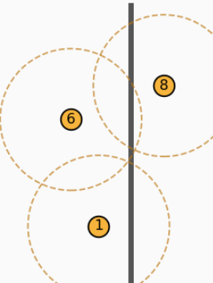
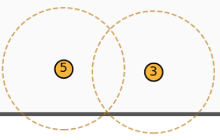
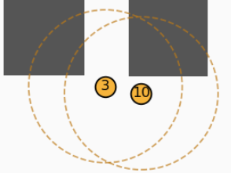
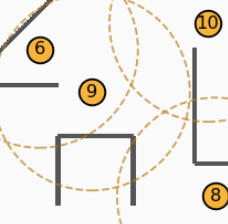

# 进阶6问题

1.Map1这个位置6号弹布弹完全不好，有覆盖，而且墙体覆盖本身就少，难度分也低完全不应该选

下面这个5和3的布弹完全可以再靠近墙体一点（这个是应为无人机自定义的安全范围太大了吗），对于这个只有一条墙体，应该越接近炸弹范围圆形直径最大，而且这么长一个墙体，完全不应该5和3还有覆盖重叠的范围

2.Map7，下面这个3和10的布弹位置这么近，而且重叠那么大也不应该选，是因为没有通信炸弹坐标问题吗，还是没有计算炸弹之间的范围，而且本身只有10个炸弹,我直接暴力循环和每个炸弹距离和计算收益完全很快，这个位置完全是错误

3.Map5下面这个9号和其他6号，10号，放那么近干嘛，完全还有很多优异位置例如左下角，是时间不够放了吗（我觉得只要找到确实很好的位置可以提前放弹 你可以按照这些地图推断下什么时候算很好 可以做个初步阈值）

分析与实测回应见[截图逐项诊断及试验](进阶6_用户截图诊断与布弹改进.md)。
