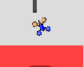
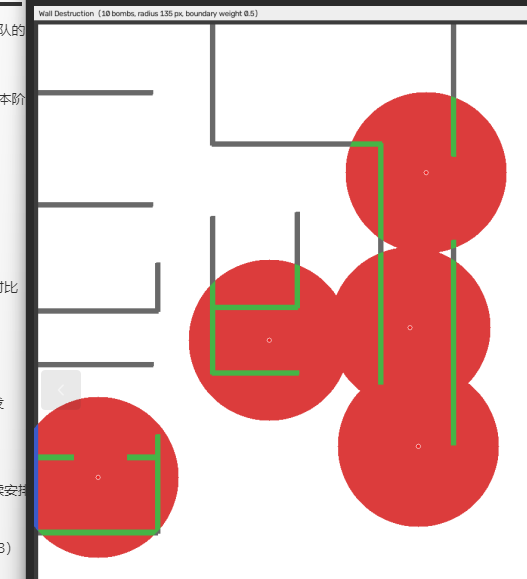
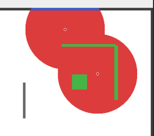
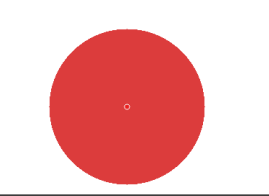
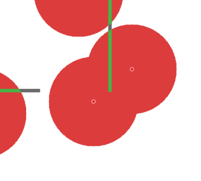
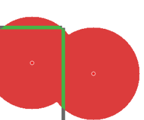
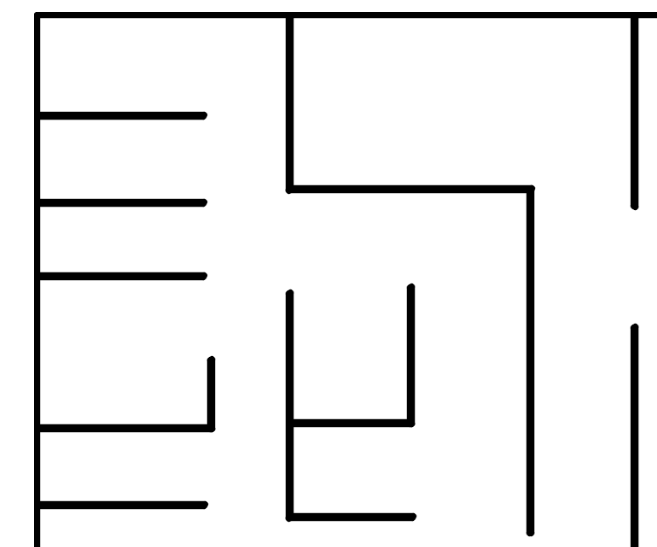

# 可直观问题：

## V1阶段问题

接下我给你梳理V1中的问题基本上每个图的问题其他图也有，你看补充你的方案或者有些是后面阶段补充的就先不管（完成问题后在后面给我写一个V1问题解决板块）

v1阶段无人机老是要碰撞墙体，无人机与无人机间也有碰撞卡位问题

### Map1

在Map1中大部分无人机都在最开始的矩形区域内徘徊只有一架走到最后？堆在一起了

### Map2

在Map2中在中间出发无人机刚开始却没分散开还一直在一起，是不是通信与合图中太久才通信，可以不可以做到实时通信？

### Map3

中无人机一个地方徘徊太久本来到这个区域已经知道有墙体不能快速离开而且还有无人机重复进入，也是有无人机间相互对撞的问题，而且也是一样刚开在初始周围徘徊太久这些问题前面图也有

### Map4

运行回放为什么窗口这么大，画图也没画完整？？？而且有无人机回头路问题走过的路感觉又停顿或者回头了一遍浪费时间，而且无人机要抖动是什么意思？

### Map5

也是有窗口显示问题，前三个都是好的，这个图也是有走回头路的问题，也有部分无人机重走别的无人机走过的路的问题，如果是选择放置炸弹发现别的路上有更好选项是好的，但是如果真的是重走就是浪费了，而且无人机有可能卡墙，例如如果飞到了墙边的地方撞到墙就卡住了，还是无人机要碰到墙的问题，而且炸弹放置位置你给我解释下你的判断呢，感觉并不是很优解

## V2阶段发现问题

后面演示代码不要只写一个 我要Map1-Map5的三个每个都单独分开演示代码我直接复制就能用

Map4，Map5地图还是大是本身地图就比前面的大 但是我要演示的时候屏幕看得全，这个窗口大小是原先题目固定的吗？如果没有给我等比例缩小点

## V3阶段发现问题

1.感觉无人机有点犹犹豫豫的感觉感觉一个入口本来已经到了进去一点又退回，在一个地方徘徊太久，而且本来就一条通路应该直接往前走就行，但是还会前后徘徊

2.然后如果无人机相遇，有的时候会停下，不能立马走开，而且有的无人机在角落还会停下不知道干什么

3.然后无人机出发点好像有蓝色框噢这个演示视频出发区好像没有这个是原先就没有吗

4.然后遇到窄路会一点点过是因为躲避墙体问题导致的吗？不能快速通过，但是感觉这个窄路也不是很窄

## V4阶段问题梳理

1.有个问题就是当无人机前面的无人机先到某个路口反而没进结果又走回去了，反而是后面到的走进去，是否有点浪费步数

2.无人机还是有徘徊，在同一地方左右徘徊，有点浪费了，然后本来是环形区域，却只是走一点退出来，别的无人机也走一点退出来，有些区域是直接绕一圈出来，但是有些还是徘徊在门口的感觉，不应该先到的无人机直接纵深探索的感觉吗，你看看那个最优

3.感觉无人机同一地方徘徊问题有点严重这个要解决，然后也有岔口或者路口进一半退出来的问题，结果后面又饭回来走，有重走路的浪费

4.出发点徘徊，有的无人机可能在别的无人机后面，有点在出发点徘徊了下的感觉，不能快速分散和到地图各位位置，也有重走别的无人机走过路的感觉，有的跟着别的无人机走了一段，这个可以修改下，当然如果前面无人机的放置炸弹位置好也是可以选择那个位置直接放置（但是如果直接去那个地方是否会增加耗时不划算 你思考下）

5.第五张图这个位置老师让无人机停在这慢慢挪动，后面也没过去，感觉只要判断入口位置能进，直接走中间不就是最快的吗，你思考下

6.然后出发点还有个问题，如果是中间出发点感觉直接分散四周最好，但是现在版本无人机有种转了一小圈再分散的感觉，不是直接分散，这个你解决下

## 2026-10-18：V4 内部修订回应与后续安排

上面的原始问题和截图保持不变。根据补充信息，重点核查 Map05 第一轮。本轮没有进入下一阶段，完成 V4 内部修改、五图各三轮评测与 41 项测试；15/15 放满并提交。低位移窗口比例 0.54%→0.12%，指定位置最长停留 223→26 帧，但重复探索和部分损伤问题没有全部解决。

| 问题 | 本次状态 | 做了什么 / 证据 | 仍存在的问题与后续安排 |
| --- | --- | --- | --- |
| V4-1 先到路口却退回，后到者进入 | 部分处理，未完全解决 | 到达半径 40→22；探索路线有 100 步有限承诺，避免立即被布弹任务替换 | 尚无完整的先到者路权协议；下一轮 V4 内加入入口认领有效期与实际推进条件，先验证再采用 |
| V4-2 环路浅入即退，缺乏纵深探索 | 未完全解决 | 加入前进方向与深度偏好，地图分 94.38→94.43 | 自身回访 28.65%→28.90%，不能称为整体重复减少；V4 内继续区分死路退回、有效绕环与无益折返 |
| V4-3 同地左右徘徊、岔口反复 | 停滞明显改善，绕行仍有 | 低位移 0.54%→0.12%；扫掠间隙恢复、持续低速检测；往返候选窗口 1.93%→1.64% | Map04 低位移 0.36%→0.44%，仍需针对该图回放定位；不能宣布五图全解决 |
| V4-4 出生区跟随、重走队友路线 | 分散部分改善，重复未解决 | 第 100 帧平均距离 403.39→444.43；所有新鲜目标参与排斥，布弹保留路径成本 | 机间重叠 46.82%→47.64%；后续 V4 需考虑入口/路线走廊占用，不能只排斥终点 |
| V4-5 Map05 第一轮墙端慢挪 | 本例长停滞明显改善 | 截图区域最长停留 223→26 帧，该区域低位移窗口 4→0；Map05 三轮低位移均为 0 | 修订轨迹仍有绕行，未证明“直接走中间且最短”；继续保留同入口穿越与碰撞回归 |
| V4-6 中间出生先转圈再散开 | 条件化分散已实现，效果部分改善 | 开阔出生点短时直接执行编号方向；第 45 帧距离 159.40→198.29 | 第 20 帧距离 98.69→89.39，Map01 第 100 帧也退步；短期初始编队避让仍需在 V4 内改进 |
| 放满、提交、无人机失活 | 本批保持通过 | 15/15 放满与提交；回放无失活机 | 不代表所有未知地图都可靠，后续每次修改继续回归 |
| 碰撞损伤 | 有代价，未解决 | 平均健康值 47.43→46.73/50，Map03 降幅较大 | 后续 V4 优先检查转角及会合拥挤，不用成绩上涨掩盖损伤 |

详细原因、试改失败记录、每图成绩、轨迹对照和 Map1～Map5 各三轮独立演示命令见 [V4 修订说明](E:/桌面/gitee/swarm-eod/阶段4_V4探索与通行修订说明.md)。按阶段展开的推进过程与阶段间问题交接见 [开发过程与问题解决总结](E:/桌面/gitee/swarm-eod/开发过程与问题解决总结.md)。

## V4阶段修改过仍有问题

1.Map2,Map3,Map4,Map5中的无人机徘徊停留较严重，老是在一个地方左右徘徊浪费步数时间,先主要解决这一个问题

## 2026-10-19：探索途中左右徘徊专项回应（仍为 V4）

原始反馈与截图保留。你补充“探索途中更明显”，本轮因此把探索与后段集合分开统计，优先处理探索中的近路点折返和持续小范围循环。完成五图各三轮、46 项测试；15/15 放满与提交，所有无人机最终活动。当前开发入口为 `MyDroneRedV4Loops`。

| 地图 | 探索短时疑似徘徊窗口：旧→新 | 结论 |
| --- | --- | --- |
| Map01 | 3.64%→2.12% | 三轮均值下降 |
| Map02 | 4.88%→3.93% | 部分改善，第一轮短窗口仍退步 |
| Map03 | 5.12%→4.17% | 部分改善，仍有正常返回与局部折返 |
| Map04 | 7.26%→5.60% | 短窗口下降，但长窗口 0→0.37%；第三轮约 2725 步才恢复离开 |
| Map05 | 7.57%→6.67% | 部分改善，残留较多，继续 V4 内处理 |
| 五图均值 | 5.69%→4.50% | 相对减少约 21.05%，不是彻底解决 |

这个比例是离线诊断，可能包含正常掉头，不是官方扣分项。使用两版相同探索帧区间，后段停靠不计入探索改善。改动包括：接近路点提前减速；根据累计运动、净位移、活动范围和新增空地识别循环；短期换区域选目标并保持恢复方向；后段符合条件后才制动等待。

**改善与代价同时保留：**健康值 46.73→48.61 /50，回访和机间重叠略降；但地图分 94.43→93.88、墙体分 61.21→58.10、已评测部分 62.66→61.76，开局分散也退步。按本轮运动优先目标采用，不能称为最高分版本。蓝队未评，最终总分待定。

**尚未解决及处理策略：**检测仍需要积累历史，Map04 出现长窗口残留；后续 V4 内先做同入口重复进退记忆并区分正常死路返回，再做带有效期的入口认领和走廊分工；同时对照恢复绕行与高收益落点的成本，追回布弹分数。这些是后续方案，本轮尚未实现，不转入阶段 5。

详细逐图评分、CPU 对比图、恢复前后轨迹、每图三轮独立回放及实时命令见 [本轮专项说明](E:/桌面/gitee/swarm-eod/阶段4_V4探索徘徊专项修订说明.md)；开发过程与问题交接已同步到持续总结。旧发布第一版 ZIP 未重新打包。

## 2026-10-19：再次反馈“同一地点左右徘徊严重”后的专项修订

本次只聚焦原地连续左右摆动，不进入下一阶段。查到旧路线在新观测后没有及时失效：Map04 第三轮 3 号机约 2545～2713 步反复追踪旧路点 `(580,71)`，局部避障不断换向，直到约 2725 步才恢复。诊断复现与旧回放物理轨迹完全一致。真实地图只用于离线核查，在线修订仅依赖已观测障碍。

已加入：每 6 步在更新网格后重查旧路线，失效即释放重选；同一路点连续 36 步没有超过 6 像素的实质接近时退出，并短期避免重新接回旧任务。当前开发入口改为 `MyDroneRedV4Progress`。

| 地图 | 原地多次反向窗口：上一版→本次（三轮均值） |
| --- | ---: |
| Map01 | 1.82%→0.61% |
| Map02 | 3.10%→0.36% |
| Map03 | 1.67%→0.00% |
| Map04 | 4.05%→0.12% |
| Map05 | 5.02%→0.25% |

五图均值 **3.13%→0.27%**，减少约 **91.51%**；15/15 放满并提交，50 项测试通过。本指标针对小范围内多次反向，不把一次正常掉头直接当成严重摆动。新版仍有少量候选，报告已全部列出时间步，不能称为彻底消除。

代价同样保留：旧宽泛短折返 4.50%→4.91%，机间重叠 46.70%→50.35%，已评测部分 61.76→61.40，平均健康值 48.61→48.36。Map04/Map05 成绩退步，因此这是针对当前问题的改进，不是综合最高分证明。

后续若继续处理，先逐段核查报告中的残留，区分旧目标冲突、队友避让和正常掉头，再考虑保留有效终点并局部修路，避免重规划带来更多无谓折返。这些后续方案尚未实现。本次不扩展到下一阶段，也未重新打包。

详见 [原地摆动专项说明、图和独立回放命令](E:/桌面/gitee/swarm-eod/阶段4_V4原地摆动修订说明.md)；持续开发总结已同步记录本次调查、代码逻辑、对照结果及问题交接。

## 2026-10-20：阶段5本轮回应

本轮已完成，默认开发入口为 MyDroneRedV5。五图各三轮示例蓝队下完整均分81.37→83.96/100；V5红队15轮、前后蓝队30轮正常完成，57项测试通过。13轮新条件提交、2轮旧墙钟兜底。正式参考组与未知地图未测；历史运行速度不同，不能把全部分差归因于算法。提交ZIP保持冻结。

关于原地左右徘徊：本轮继承V4修复，没有新增运动算法。共同探索区间反向0.2512%→0.2277%，Map04反而退步，Map02/03出现长窗口；回访26.0126%→26.5528%、重叠48.2620%→48.4802%，健康48.36→48.24。因此不能说全部解决，也不能用完整分提高掩盖运动问题。

后续先协调时间步与墙钟预算；按报告片段区分正常返回、让行、无效规划，研究保留终点的局部修路；再做带时效的走廊认领与更强蓝队评测。这些尚未实现，本次不进入下一阶段。

[阶段5说明](E:/桌面/gitee/swarm-eod/阶段5_V5完整评分与结束时机说明.md)已补齐逐图分数、CPU对照、60条独立回放与5条实时命令；[开发过程总结](E:/桌面/gitee/swarm-eod/开发过程与问题解决总结.md)已补齐任务、代码逻辑及阶段间问题交接。

## 进阶1阶段问题

1.墙体分还有优化空间，像Map1有个角落的墙体你没布局到，而且有个炸弹下面这个明显不优，放角落最优，感觉还能优化

2.像Map2中左上角墙体还有很大空间，却没用到，反而集中在右下墙体部分，是本身无人机分散不好吗？还是布弹问题

3.Map4中有大的墙体这种直接覆盖是不是会更好？然后这种的墙体画图是不是像这种封闭的里面可以直接填充？

4.处置区旁边的墙体还是没有补齐，这个我觉得如果无人机无法探索位置，像Map1，Map2，Map4这种应该可以就直接墙体补全，然后Map3，Map5在中间本身可以探索到的就本身没有墙体就不管

## 进阶2阶段问题

1.感觉为什么Map4的地图墙体覆盖还是不够好 有明显可以优化的，下面第一个图这个炸弹位置很明显，而且墙体分占很少，很明显的低收益，第二图可以明显看到左上角更加里面蓝队无法更难触碰的位置却没有放，这有明显可以优化的地方

2.Map3下面这个炸弹位置也不好，不如角落位置更远，而且墙体覆盖更多

3.Map2这个地方的炸弹有覆盖明显也不如放在角落好

感觉布弹位置还有优化空间，而且应该也要考虑蓝队难度，对那些角落远地方难走路的墙体多覆盖的高收益应该要选，针对这个布弹策略再次优化

## 进阶3阶段问题

1.Map2这次居然有空放炸弹一点墙体都没有覆盖到，这个完全不应该，其他图占比还可以，Map1的感觉仍然可以再让一个炸弹占一个角落，这个收益更大

2.Map3的炸弹有覆盖点（两处比较严重），也是还不如放角落收益大，还有优化空间

## 新地图阶段问题梳理

1.地图探索不全，这个区域进阶2和进阶3强化都没有探测到，是无人机进不去吗？还是限制无人机的伤害范围不能进？

2.进阶3强化，这个区域居然没有探测到？？完全不应该

3.并且布弹策略，这个新地图的布弹，像进阶2的第一轮，三个炸弹直接布在初始点外面很近的地方，这个完全有问题，进阶3强化也有部分这个问题，完全没有在左上角又远，又收益高的地方布弹，如果探查地图已经查到，应该选择这个区域吧

4.而且无论进阶2还是进阶3强化，都是在出发点有3架左右无人机徘徊严重，在出发点徘徊好久才出发，不应该直接向未知深地方前进吗，而且探索深的就那么1-2架，可以理解先进无人机先去探索更深的地方，那么其他多架无人机不应该重走已经走过的路，感觉需要给无人机配合，比如说排1-2架优先去探索深的地方，1-2架优先查看周围的，在1-2架干什么，是不是更好，而且这个出发感觉也可以解决都是向未知地方前进，也可以这样区分配合，而且还是有多个炸弹范围覆盖严重问题，在布弹的时候没有计算之前布弹和这个布弹范围的重叠吗？，不应该优先选择收益高难度大的吗？

## 尝试进阶4阶段问题

1.徘徊问题相当严重